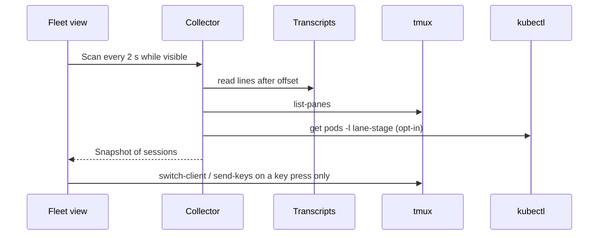

## Context

Agents do most of the work in the projects b9s shows. A person runs a dozen
Claude Code and Codex sessions in tmux windows across several repositories,
and Omnigent runs lane agents in pods. b9s showed the issues those agents
change, but not the agents: which ones run, which task each one holds, which
wait for an answer, and what each has loaded into its context window. Nobody
could tell that a session still worked from an old copy of `AGENTS.md`, or
which agent made a commit.

The agents expose no common API. What they do leave behind:

- Claude Code appends one JSON line per event to
  `~/.claude/projects/<cwd>/<session>.jsonl`, with token usage per reply,
  compaction markers, tool calls and hook output.
- Codex appends to `~/.codex/sessions/YYYY/MM/DD/rollout-*.jsonl`, with
  `token_count` events and the `AGENTS.md` text it was given.
- tmux knows each pane's window name, working directory and command.
- Lane pods carry the `omnigent.ai/lane-stage` label and write their log to
  stdout.

## Decision

b9s reads agent sessions from these four sources and never writes to them.

- **Transcripts are read-only and incremental.** The collector keeps a parse
  state and an offset per file, and reads only complete lines appended since
  the last scan. A file that shrinks is read again from the start.
- **tmux is read with `list-panes`.** A session matches the pane whose window
  carries its name, else the most recent session in the pane's directory.
  b9s calls `switch-client` and `send-keys` only when the person presses `a`,
  `Ctrl-K` twice, or sends text with `i`.
- **Kubernetes is read with `get` and `logs` only**, and only when
  `fleet.pods.enabled` is set. b9s runs no other kubectl verb.
- **Context is an estimate, labelled as one.** The window size comes from the
  last usage record. Each source is sized at four characters per token, and
  the remainder counts as system prompt and tool schemas. A source is stale
  when its file changed after the session loaded it.
- **The git log comes from the git CLI**, parsed and drawn by b9s itself. A
  commit belongs to the agent session that worked in the same project while
  the commit was made.

## Options considered

- **Ask each agent over an API or hook.** Claude Code hooks could post events
  to b9s, but only for sessions started after the hook exists, only while b9s
  runs, and never for Codex or the past 48 hours. Rejected: the transcripts
  already hold everything, for every session.
- **Parse the whole transcript each scan.** Simple, but a long lane session
  writes tens of megabytes. Rejected for the incremental read, which takes a
  rescan of 40 sessions from 2.2 s to about 15 ms.
- **Count tokens with a tokenizer.** Exact per model, but it needs a model
  specific vocabulary in b9s for numbers a person reads as shares. Rejected:
  the window total is exact from usage records, and the shares are marked as
  estimates.
- **Reuse lazygit for the commit log.** It brings a whole application and its
  configuration for one view. Rejected: `git log` with a fixed format and a
  small lane graph covers the commits view.

## Consequences

- The fleet works for any session on the machine, including those started
  before b9s, with no setup.
- A transcript format change in Claude Code or Codex can blank fields. Unknown
  lines are skipped, and the parser tests pin the fields b9s reads.
- A session in a pane whose window has another name, in a directory shared
  with a newer session, can match the wrong pane.
- Context shares are approximate. Totals per window are exact.

## Advice

- Keep every new source read-only. An action on an agent needs an explicit
  key and must not run under `B9S_TEST_MODE`.
- Add a new agent tool as one more `feed` function and a fixture transcript,
  not as a special case in the collector.
