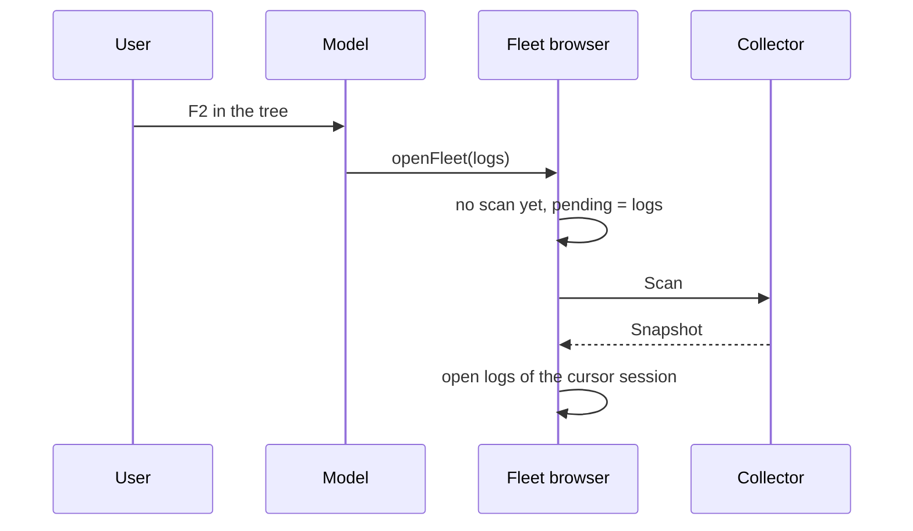

## Context

ADR 0034 gave `F1`-`F4` to the issue types (epic, feature, task, bug) and
left `F5` as a second reload key beside `Ctrl-R`. ADR 0067 added eight
screens for the agents that work in the projects: agents, logs, context,
projects, xray, pulse, commits and a commit detail. Each needed a `:` command
or a chain of keys from another screen.

The owner wants the eight screens on `F1`-`F8`, in the order of the mockups
(T1 to T8). That is the k9s shape ADR 0034 cited: one function key per
resource view. The types are filters of one view rather than views of their
own, and `:epic`, `:feature`, `:task`, `:bug` and `:chore` already switch the
type with the same replace semantics.

## Decision

**`F1` agents, `F2` logs, `F3` context, `F4` projects, `F5` xray, `F6` pulse,
`F7` commits and `F8` commit detail, in every issue view and inside the
fleet. The type quick filters leave the function keys, and `F5` is no longer
reload.**

- `F2` and `F3` open the session under the agents cursor, and `F8` the commit
  under the commits cursor. Before the first scan or log read, the browser
  records the screen as pending and opens it when the data arrives, so a key
  pressed at startup is never lost.
- `F4` opens the `:projects` table, which lives outside the fleet browser.
  Inside the fleet, `F4` closes the fleet and runs `projects`.
- A function key from inside the fleet resets the stack to the screen's root
  (`agents` for logs and context, `commits` for the detail), so `Esc` goes back
  one step as it does after `Enter`.
- Types switch with the type commands at `:` or a hotkey. The header legend
  names the command beside each type, and the footer shows `F1-8 fleet`.
- `Ctrl-R` alone reloads. `f1`-`f8` are built-in keys, so a hotkey that takes
  one needs `override: true`.

## Options considered

- **F1-F8 for the fleet, types on `:` commands** (chosen): one key per
  screen, in mockup order, and nothing lost because the commands cover the
  types.
- **Fleet on `F5`-`F12`, types kept on `F1`-`F4`**: keeps ADR 0034, but the
  order no longer matches T1-T8, and `F9`-`F12` are taken by macOS and many
  terminals.
- **Open logs, context and the detail only when data is there**: simpler, but
  a key pressed before the first two-second scan would do nothing visible.

## Consequences

Every fleet screen is one key away from anywhere. A user used to `F1` for
epics types `:epic`, or binds `F1` back with a hotkey and `override: true`.
`F5` users press `Ctrl-R`. Terminals that send function keys to the system
need `fn`, as before.

## Advice

- A new fleet screen gets a `:` command first. Add a function key only when a
  free one exists; do not shift the eight.
- Keep `fleetFunctionKeys` and the README key table in one change.
