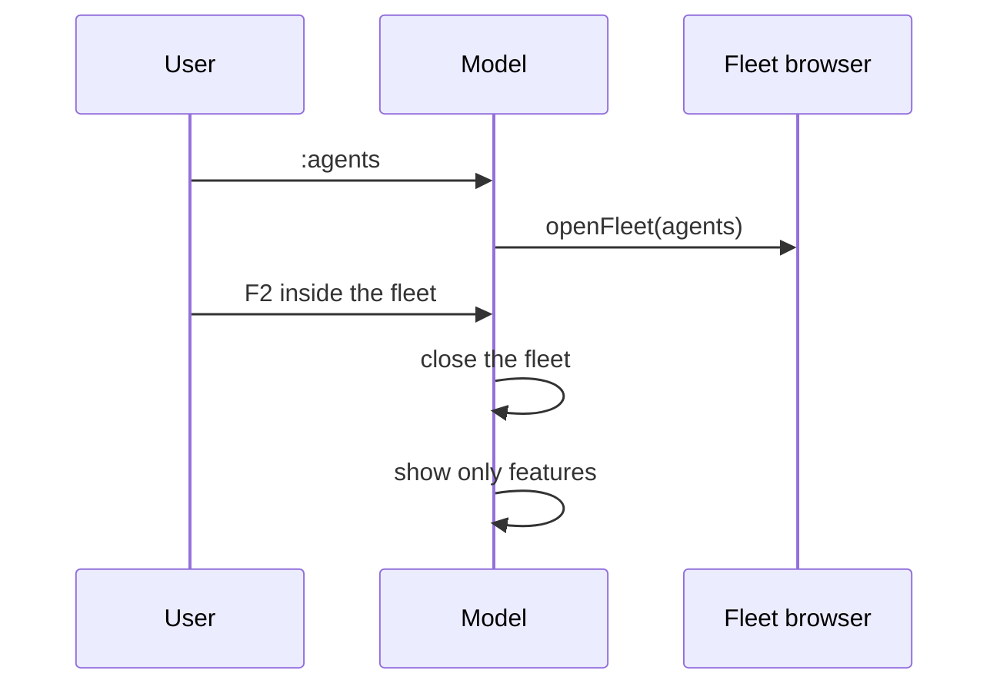

## Context

ADR 0068 moved `F1`-`F8` to the eight fleet screens and took the type
filters (ADR 0034) and the `F5` reload off the function keys. In use, the
owner found that the fleet keys broke bindings they rely on in every issue
view: `F1`-`F4` for one type and `F5` for reload. k9s itself opens a resource
view from a `:` command, not from a function key, so the fleet does not need
the keys to follow the k9s pattern.

## Decision

**The function keys go back to ADR 0034: `F1`-`F4` show one type and `F5`
reloads, in every view. The fleet opens from `:agents`, `:xray`, `:pulse` and
`:commits`, `Tab` cycles its root views, and `Enter`, `c` and `Esc` move
between a list and its detail.**

- Inside the fleet, `F1`-`F5` close the fleet and then do what they do in
  the issue views, so a key never means two things. With a prompt open
  (search, inject) the keys go to the prompt.
- The web removes its fleet function keys too. `F5` reloads there, and the
  Fleet tab's own bar opens each fleet page.
- The `:` commands keep the fleet's stack: a command opens its view as a
  root, so `Esc` closes the fleet from it.

## Options considered

- **Commands and Tab for the fleet, function keys for issues** (chosen): the
  keys keep one meaning everywhere, and the fleet opens like a k9s resource.
- **Function keys for the fleet only while it is open**: no conflict in the
  issue views, but `F1` would mean two things depending on the screen, and the
  type keys would stop working in the fleet.
- **Keep ADR 0068 and let users rebind with `override: true`**: every user
  who relies on ADR 0034 would have to write five hotkeys.

## Consequences

Each fleet screen needs a `:` command or a key from another fleet screen.
`F1`-`F4` and `F5` behave as before ADR 0068, and their hotkey overrides work
as ADR 0035 describes. This supersedes ADR 0068 and restores the decision
of ADR 0034, which stays marked as superseded by 0068 for the record.

## Advice

- A new fleet screen gets a `:` command, or a key inside the fleet. Do not
  bind a function key to it.
- Keep `fleetIssueKeys` equal to the function keys the issue views own.
