# Data IO: how b9s and bd read and write Beads

This document explains how data moves between b9s, the `bd` CLI and the Dolt
store. It also covers the newer IO mechanisms in upstream Beads (`bd serve`,
the proxied server, the HTTP backend) and the BDP wire protocol. It is
background reading. [ARCHITECTURE.md](ARCHITECTURE.md) and the
[ADRs](adr/) remain the references for what b9s decides.

Status as of 2026-10-14: b9s v1.3.4. Upstream Beads `main` at `048f5e5`, latest
release tag `v1.3.1` (2026-09-30), release candidate `v1.3.2-rc.2`
(2026-10-10).

## Contents

- [The short version](#the-short-version)
- [Background: Dolt and the Beads storage modes](#background-dolt-and-the-beads-storage-modes)
- [How b9s finds a store](#how-b9s-finds-a-store)
- [How b9s reads](#how-b9s-reads)
- [How b9s notices changes](#how-b9s-notices-changes)
- [How b9s writes](#how-b9s-writes)
- [Inside bd: how a write reaches Dolt](#inside-bd-how-a-write-reaches-dolt)
- [Inside bd: starting and finding the server](#inside-bd-starting-and-finding-the-server)
- [New in recent bd](#new-in-recent-bd)
- [BDP, the bead-graph wire protocol](#bdp-the-bead-graph-wire-protocol)
- [What this means for b9s](#what-this-means-for-b9s)
- [Glossary](#glossary)
- [Sources](#sources)

## The short version

b9s reads the store directly and writes only by running `bd`. Reads go
straight to the data because they must be fast and support live reload. Writes
go through `bd` so that every rule `bd` enforces on create, update, close and
delete also applies to changes made in b9s.

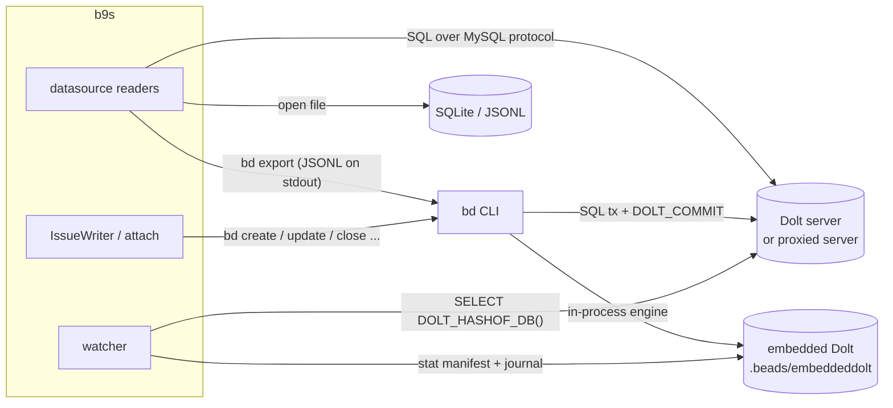

There is one exception to "read directly": an embedded Dolt store is read by
running `bd export`, because opening the store would lock out the user's own
`bd` writes ([ADR 0025](adr/0025-read-embedded-dolt-through-bd-export.md)).
The Memory Beads preview is also read only through `bd`
([ADR 0041](adr/0041-retain-cli-memory-reads-after-transport-probes.md)).

b9s does not use `bd serve` or BDP today.

## Background: Dolt and the Beads storage modes

**Dolt** is a SQL database with Git-style versioning. A Dolt server speaks the
MySQL wire protocol, so any MySQL client, including Go's
`go-sql-driver/mysql`, can query it. Two layers matter for IO:

- The **working set** holds the current rows. A normal SQL `COMMIT` ends a
  transaction and changes the working set, but it does not create a Dolt
  commit.
- A **Dolt commit** (`CALL DOLT_COMMIT(...)`) snapshots the working set into
  history, like `git commit`. `HASHOF('HEAD')` changes only then.
  `DOLT_HASHOF_DB()` hashes the working set, so it changes on every write,
  committed or not. That is why b9s polls it.

**Beads** keeps issues in Dolt (or, for older projects, SQLite or JSONL).
`.beads/metadata.json` names how the store is reached in `dolt_mode`:

| `dolt_mode` | What runs | Who can open it |
|---|---|---|
| `embedded` (default for `bd init`) | Dolt engine inside each `bd` process. Data in `.beads/embeddeddolt/<db>/` | One process at a time. `bd` opens it per command and releases it on exit |
| `server` | A `dolt sql-server`, started by `bd` on demand or run by you. Port recorded in `.beads/dolt-server.port` | Many clients at once over TCP |
| `proxied-server` | A loopback proxy in front of a private `dolt sql-server`, supervised by `bd`. Used by Gas City workspaces and rigs | Many clients, through the proxy, as `root` without a password |

A shared server (`BEADS_DOLT_SHARED_SERVER`, port 3308) is a setting, not a
separate `dolt_mode` value.

## How b9s finds a store

`DiscoverSources` in `internal/datasource/source.go` reads files only. It
never asks `bd` where the data is.

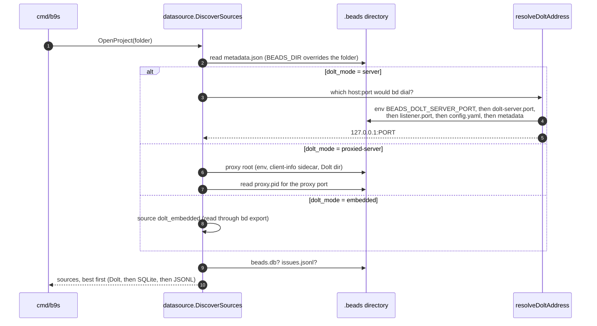

A Dolt source always wins. If the Dolt connection fails, b9s falls back to
SQLite and then JSONL and records the error for the `D` health popup. An
embedded store never falls back to a JSONL file beside it, because that file
may be months old.

The password from `BEADS_DOLT_PASSWORD` goes only to a loopback address or an
endpoint listed in `B9S_TRUSTED_DOLT_ENDPOINTS`, so a cloned repository cannot
redirect it ([ADR 0013](adr/0013-trust-dolt-endpoints-before-sending-environment-credentials.md)).
A proxied store never gets the password.

## How b9s reads

### Dolt server: plain SQL

`DoltReader` in `internal/datasource/dolt.go` opens a small MySQL connection
pool (two connections) and runs four queries per load. It reads the `issues`
table first, then labels, dependencies and comments in one batch each, so a
load costs four queries, not one per issue.

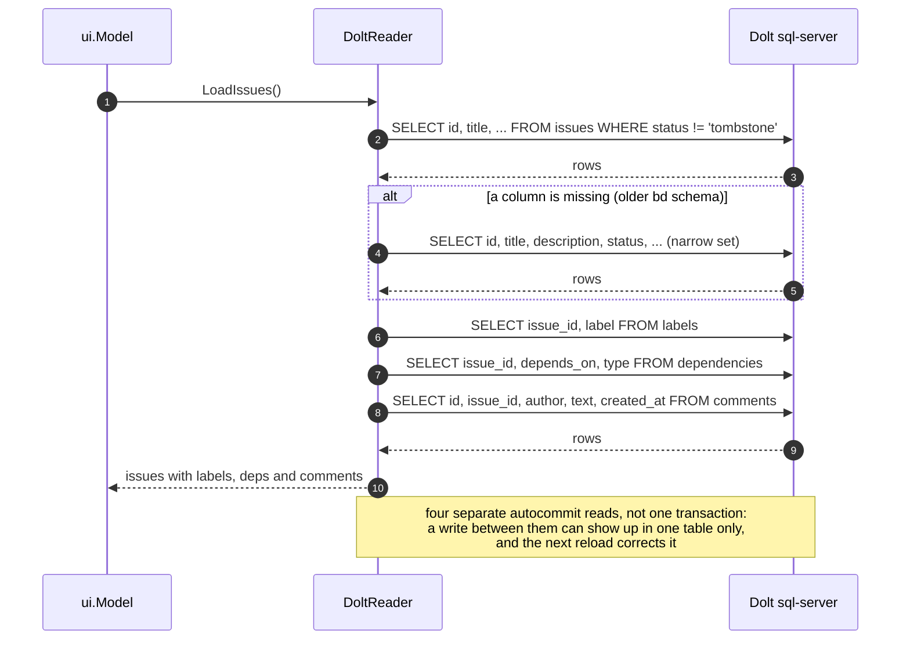

The fallback to the narrow column set fires only on a "missing column" error.
Any other failure, such as a dropped connection, is reported unchanged.

### Proxied server: the same SQL through bd's proxy

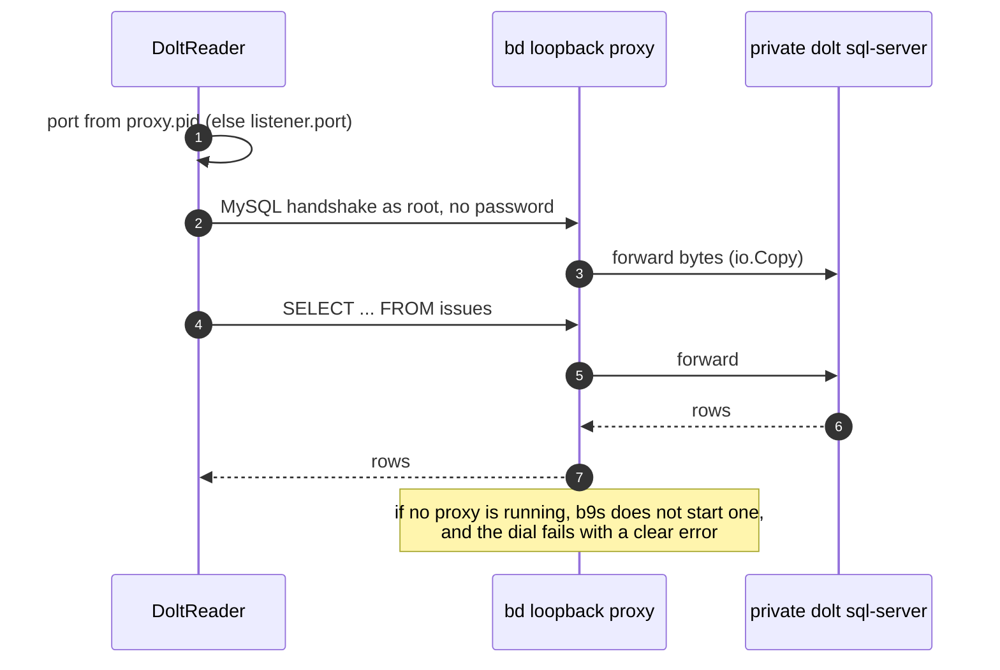

### Embedded Dolt: through `bd export`

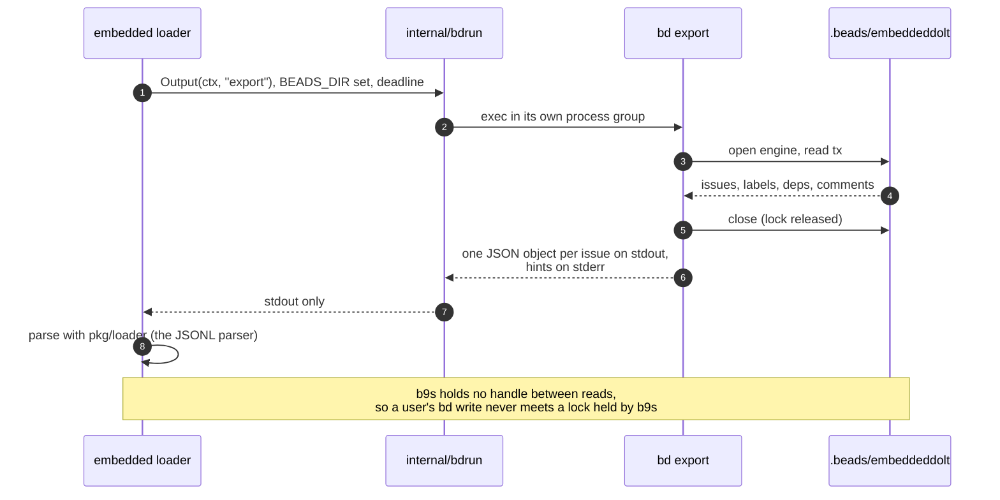

A small project exports in about 0.4 s. The watcher triggers a reload only
after a write, so the cost is paid once per change.

### Memory Beads preview: many `bd` calls

A graph workspace (`graph_mode: "link"` in `metadata.json`) holds Memories and
typed Links that the issue readers do not understand. b9s reads it entirely
through the matching preview `bd`, after a capability probe
([ADR 0045](adr/0045-probe-bd-help-before-memory-reads.md)).

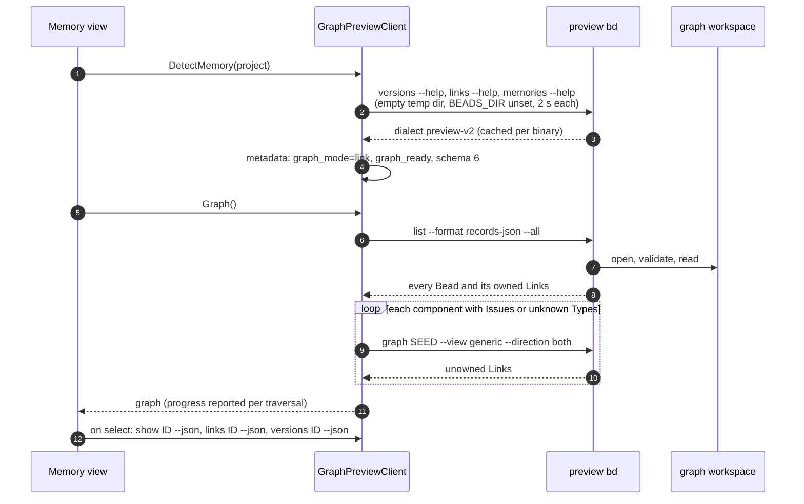

A complete read of a 57-Bead graph took 5 to 8 seconds in the
[transport investigation](memory-read-research.md). Each `bd` process costs
about 0.4 s to start. That cost is why BDP was measured as an alternative
(see [below](#bdp-the-bead-graph-wire-protocol)).

### SQLite and JSONL

`SQLiteReader` opens `beads.db` read-only. JSONL is parsed by `pkg/loader`,
which picks the file by canonical name first (`beads.jsonl`, `issues.jsonl`,
`beads.base.jsonl`).

## How b9s notices changes

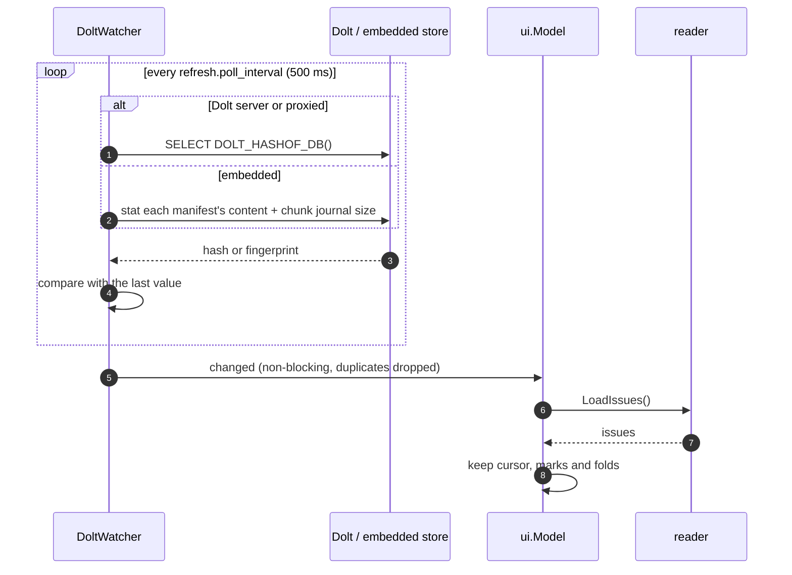

- `DOLT_HASHOF_DB()` covers the working set, so a `bd` write appears even with
  `dolt.auto-commit` set to `off` or `batch`.
- The embedded fingerprint ignores `journal.idx` and temporary manifests,
  because `bd` rewrites those even when it only reads. Counting them would make
  each reload trigger the next.
- JSONL and SQLite use fsnotify, with polling on NFS and SMB.

## How b9s writes

### Issues: `IssueWriter` runs `bd`

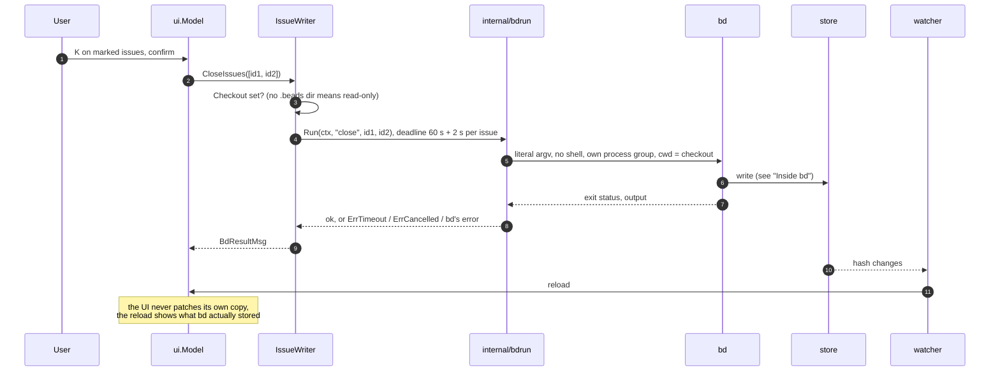

Every write is one of `bd create`, `bd update`, `bd close`, `bd delete --force`,
`bd defer` or `bd comments add`. Bulk actions pass all marked IDs in one call.
At the deadline `bdrun` kills `bd` and its whole process group. If `bd` exits
on its own, its exit status decides the result, even when a child process it
started still holds the output pipe open.

### Attachments: blob first, then a comment through `bd`

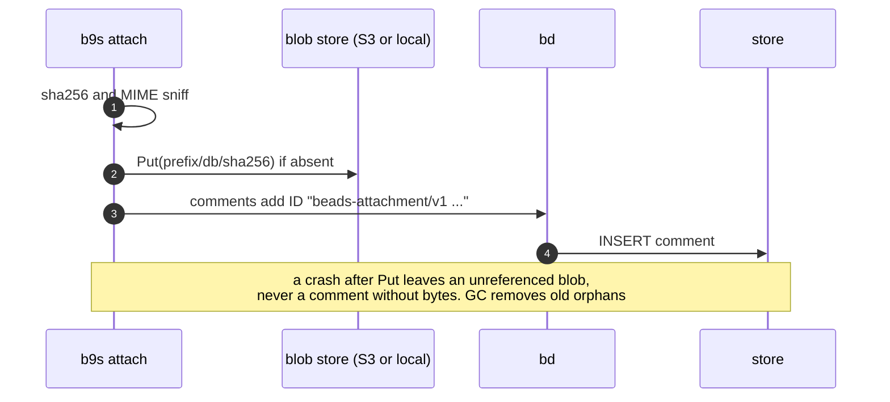

See [ADR 0024](adr/0024-attach-files-through-reference-comments.md).

### The web UI

`b9s web` uses the same readers, watcher and `IssueWriter`. A browser write is
an HTTP request that ends in the same `bd` call.

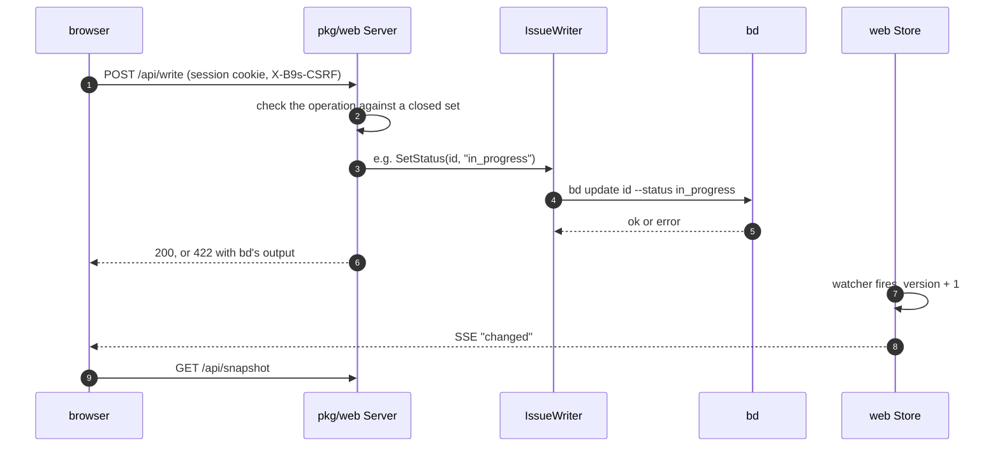

## Inside bd: how a write reaches Dolt

A `bd` write is two steps: a SQL transaction that changes rows, then a Dolt
commit that records them in history. `dolt.auto-commit` decides whether the
second step happens on every command:

| `dolt.auto-commit` | Effect |
|---|---|
| `on` (default) | One Dolt commit per write command |
| `batch`, `off` | Changes stay in the working set until `bd dolt commit` (or an explicit commit point such as `bd batch`) |

### Server mode

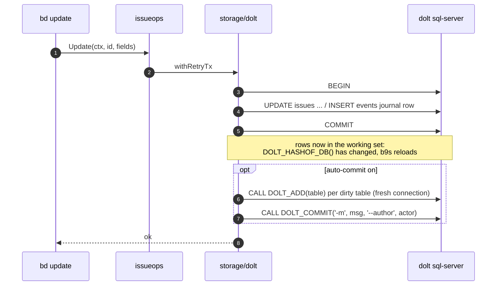

Dolt merges concurrent transactions cell by cell. Two writers that change
different columns of the same row both succeed. A conflicting write to the
same cell fails with error 1213, and `withRetryTx` replays it. Wisps and other
"no history" rows live in `dolt_ignore`d tables and are never committed.

### Embedded mode

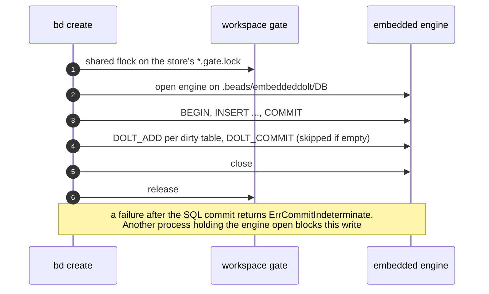

### Proxied mode and `bd serve`: one pinned connection

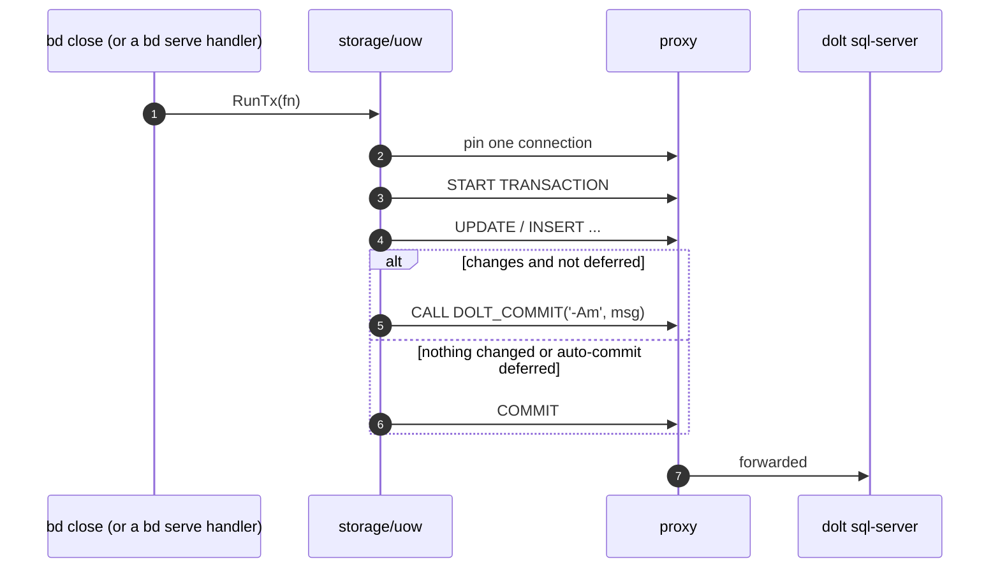

`bd serve` always commits per request. It does not run hooks or the per-command
auto-commit step.

## Inside bd: starting and finding the server

### Server mode auto-start

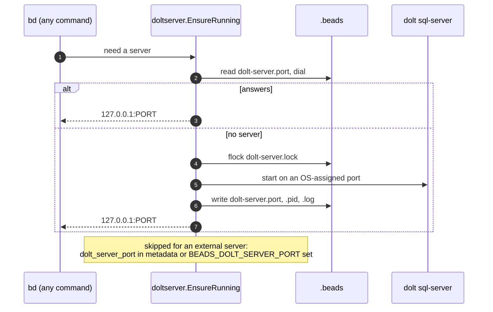

This is why b9s reads `dolt-server.port` before anything in `metadata.json`.
A server `bd` started for itself is recorded only there.

### Proxied-server lifecycle

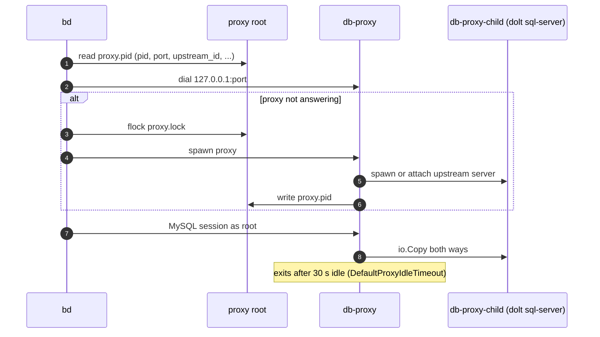

The proxy root is `BEADS_PROXIED_SERVER_ROOT_PATH`, else `root_path` in
`.beads/proxied_server_client_info.json`, else the Dolt data directory. b9s
follows the same order but never spawns a proxy.

## New in recent bd

| Mechanism | What it is | Since | Status |
|---|---|---|---|
| `bd serve` HTTP API v0 | JSON over HTTP in front of a SQL-server workspace | v1.2.1 (6 operations), about 43 today | Shipped |
| Events journal | Append-only `bd_events_journal` table, one row per write, readable as pages or an SSE stream | v1.2.1 | Shipped, opt-in (`events-journal` config or `BD_EVENTS_JOURNAL`) |
| Revisions and CAS | Opaque `revision` per issue; writes can require `expected_version`, `--if-revision`, `--if-status`, `--if-assignee` | `--if-*` in v1.2.1, `revision` in v1.3.0 | Shipped |
| Proxied server | Loopback proxy plus private `dolt sql-server`, supervised by `bd` | v1.3.0 for most users | Shipped. Default for managed local setups, but plain `bd init` still writes `embedded` |
| HTTP backend, `bd connect` | `bd` itself talks to a remote `bd serve` instead of Dolt | upstream `main` only | Unreleased, marked experimental |
| Versioned beads | `issue_versions` history written beside each change | upstream `main` | Plumbing only, not enabled in the CLI |
| Bead graph, Memory Beads, BDP | Typed Beads and Links in a graph store, served over BDP | feature branches | Design and preview builds |

### `bd serve`: the HTTP API v0

`bd serve` runs in the foreground and listens on `127.0.0.1:0` by default (a
free port). It prints one line, `bd serve: listening on http://127.0.0.1:PORT`.
There is no pid or port file, so a client must be given the address. It
refuses an embedded workspace: "bd serve requires a Dolt SQL server".

Wire basics:

- Cleartext HTTP. Success bodies are `application/json`. Every error is
  `application/problem+json` (RFC 9457) with `status`, `title`, `code` and
  `request_id`.
- Paths live under `/v0/beads/`. Custom actions use a `:verb` suffix, for
  example `POST /v0/beads/issues/{id}:close`.
- Requests with a body must send `Content-Type: application/json`, as a CSRF
  guard. The `Host` header is checked against an allowlist against DNS
  rebinding.
- Auth is off on loopback. `--auth-token-file` (or `BEADS_SERVE_TOKEN_FILE`)
  turns on `Authorization: Bearer`. Listening beyond loopback requires a token
  or an explicit `--insecure-no-auth`.
- Optional request headers: `Bd-Project-Id` (refused on mismatch) and
  `Bd-Wire-Revision` (the wire shape the client expects; the server is at 2).

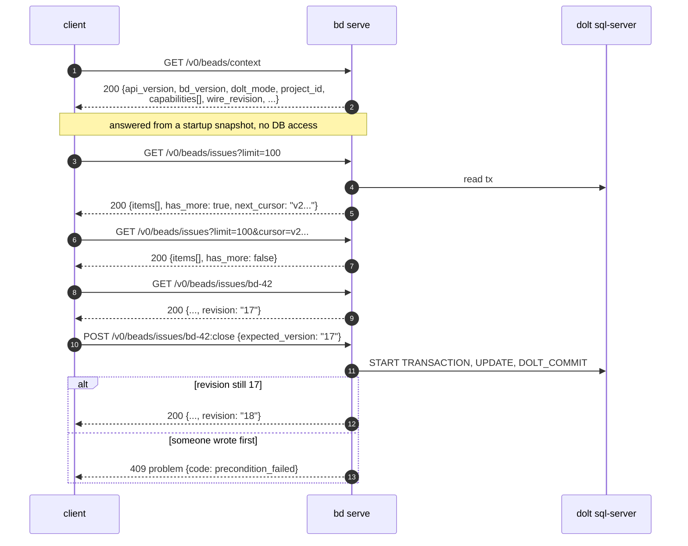

`capabilities[]` lists operation tokens such as `issues.list`, `issues.update`,
`events.list` and `memories.list`. The `memories.*` tokens refer to the
key/value memories stored as `kv.memory.*` config rows, not to Memory Beads.

### The events journal and its stream

When the journal is on, each write appends a row in the same transaction. A
client can read it by sequence number, or stream it.

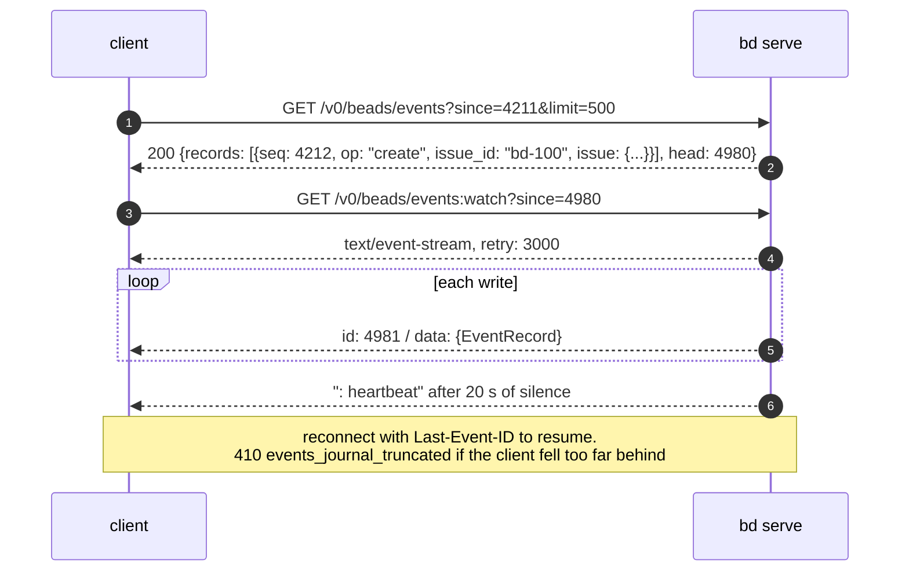

This is the first push-style change feed in Beads. Today b9s detects changes by
polling a hash instead.

### The HTTP backend: `bd` as a client of `bd serve`

On upstream `main` only, `bd connect URL` checks the server's `/context`
(API version, wire revision, optional expected project id). It then writes
`.beads/http_target.json` and sets `backend: "http"` in `metadata.json`. From
then on every `bd` command in that checkout sends HTTP requests instead of SQL.

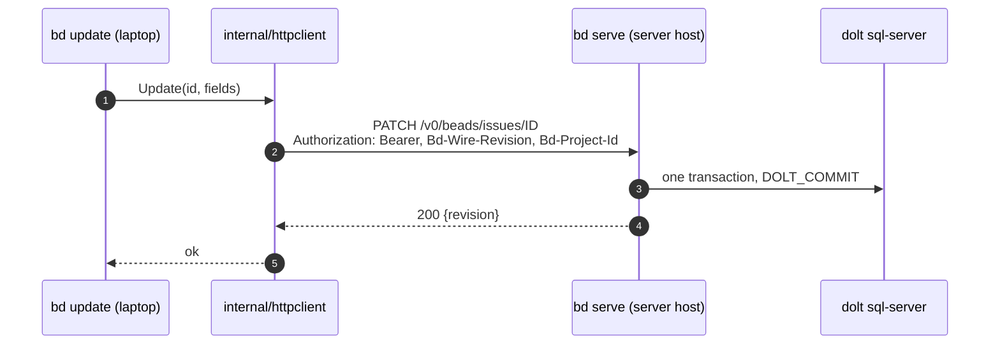

Tokens come from `BEADS_HTTP_TOKEN=host[:port]=TOKEN`, then
`BEADS_HTTP_TOKEN_COMMAND`, then a credentials file. For b9s this matters
because such a checkout has no Dolt address to read
([below](#what-this-means-for-b9s)).

## BDP, the bead-graph wire protocol

BDP is an external specification (`gastownhall/bdp`, `docs/specs/bdp.md`) for
serving typed **Beads** and **Links** with stable identity, revisions and
ownership. The beads repository never spells out the acronym. Upstream plans to
serve BDP for the bead graph (the Memory Beads work), not for ordinary issues.

Status: the plan (`engdocs/BDP_BEAD_GRAPH_PLAN.md`) and architecture
(`engdocs/BDP_GRAPH_ARCHITECTURE.md`) are drafts on upstream `main`. The P0 Read
schema is adopted. The implementation lives on feature branches
(`feat/memory-beads` and related). No released `bd` serves BDP.

How it is meant to fit:

- BDP routes mount inside the same `internal/httpapi` server as the v0 API, as
  a second route table behind the same deadline, bearer and project checks.
- Only `bd --graph-mode link serve` creates ("mints") the graph scope.
  Plain `bd serve` shows no BDP routes when there is no graph.
- v0 serves BDP from SQL-server workspaces only. Embedded workspaces never
  serve it.
- Revisions are opaque and compared only for equality. A deleted resource
  carries `deleted: {resourceKind, resource: {id, type, revision}}`. Errors are
  RFC 9457 problems with types such as `resource-pruned` and `resource-erased`.

### A BDP read, end to end (design)

Every read checks, inside its own transaction, that the store is still the one
this workspace has authority over. This guards against a copied or restored
database answering as if it were the original.

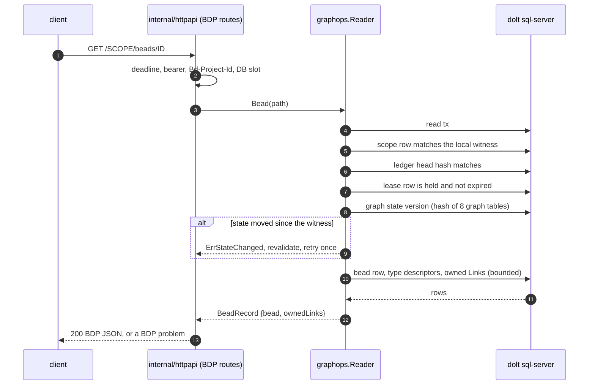

### What b9s measured against a preview build

The [transport investigation](memory-read-research.md) (2026-10-03) ran a
pinned preview `bd serve` on an isolated copy. What it observed there is
preview behaviour, not a released contract:

- Two collections, `beads/` and `links/`, paged with a `next` continuation.
- A continuation keeps its collection's original snapshot. A fresh request can
  see a later write, so a Bead page and a Link page can disagree.
- Resource ETags, but no graph-wide revision and no event stream.
- No history: `?version=TOKEN` answered HTTP 400 `invalid-parameter`, and the
  discovery document advertised Read only.
- An embedded workspace could not serve BDP.

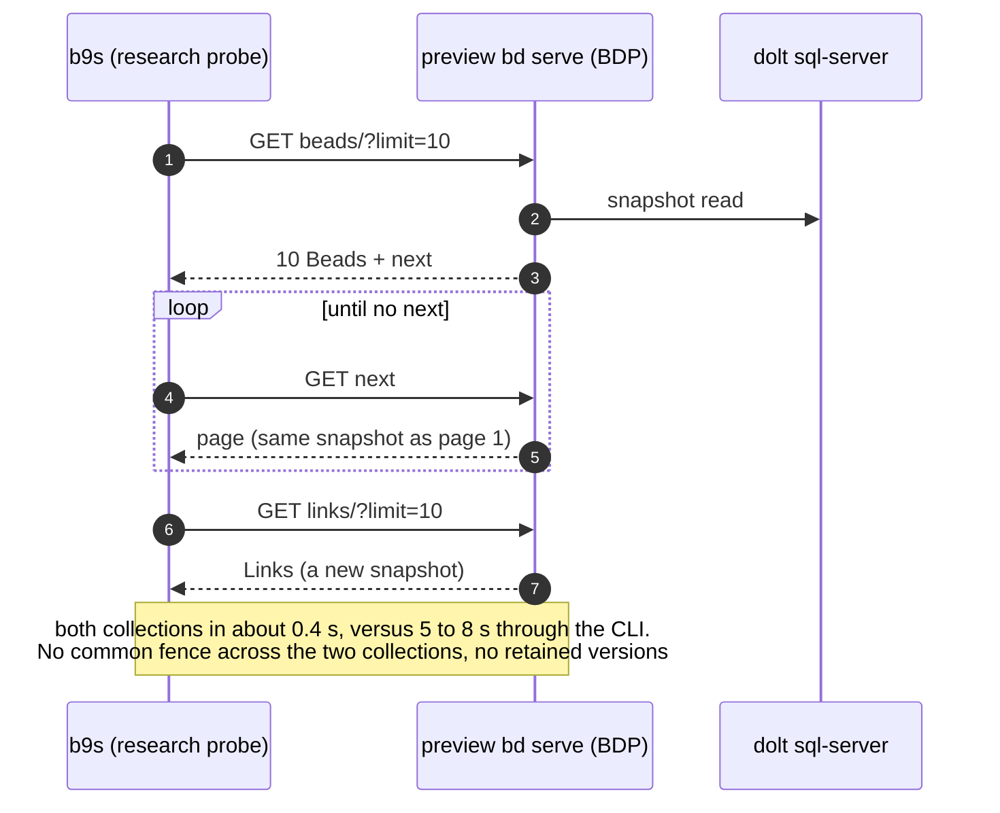

## What this means for b9s

| Path | Today | What would change it |
|---|---|---|
| Issue reads | SQL to Dolt, `bd export` for embedded | A checkout on the HTTP backend has no Dolt address. b9s would need to read through `bd serve` (or through `bd export`) to open it |
| Issue writes | `bd` CLI | Nothing pressing. `bd serve` writes would save process startup and offer CAS through `expected_version` |
| Change detection | Poll `DOLT_HASHOF_DB()` or the embedded fingerprint | `events:watch` could replace polling where a `bd serve` runs and the journal is on |
| Memory graph | Many preview `bd` calls | BDP is the preferred candidate for server workspaces once it offers a common snapshot or graph revision and a history path ([ADR 0041](adr/0041-retain-cli-memory-reads-after-transport-probes.md)) |

None of these are planned work. They are the points where upstream changes
would touch b9s.

## Glossary

- **Working set**: Dolt's current, uncommitted state of the rows.
- **Dolt commit**: a history snapshot made by `DOLT_COMMIT`, separate from a SQL `COMMIT`.
- **Checkout**: a folder with a `.beads` directory. b9s writes only for a checkout.
- **UOW**: unit of work. `bd`'s pinned-connection transaction helper for proxied and served writes.
- **Revision**: an opaque per-issue token returned by `bd serve`. Compared for equality, never ordered.
- **Wire revision**: the version of the HTTP API's JSON shape, not of the data.
- **Scope, witness, lease**: BDP graph terms. The scope is the graph's identity, the witness is the local record of which store this workspace owns, and the lease is the row that proves it still holds that store.

## Sources

b9s: `internal/datasource/{source,dolt,dolt_address,proxied_server,embedded,dolt_watcher,graph_preview,memory_graph}.go`,
`internal/bdrun/{bdrun,capability}.go`, `pkg/ui/issue_writer.go`,
`internal/attach/add.go`, `pkg/web/write.go`, [ARCHITECTURE.md](ARCHITECTURE.md),
ADRs 0013, 0024, 0025, 0041, 0045, [memory-read-research.md](memory-read-research.md).

Upstream Beads (`gastownhall/beads` `main` at `048f5e5`, tags `v1.3.1`, `v1.3.2-rc.2`):
`internal/httpapi/spec/openapi.v0.yaml`, `internal/httpapi/{routes,wire_revision,cursor,problem,auth}.go`,
`cmd/bd/serve.go`, `engdocs/SERVE_RUNBOOK.md`, `docs/reference/events-journal.md`,
`docs/reference/configuration.md`, `internal/storage/{dolt,embeddeddolt,uow,dbproxy}`,
`internal/doltserver/doltserver.go`, `internal/httpclient`, `cmd/bd/http_backend.go`,
`VERSIONED-BEADS-WRITE-PATHS.md`, `PROPOSAL-cas-conditional-update.md`,
`engdocs/BDP_BEAD_GRAPH_PLAN.md`, `engdocs/BDP_GRAPH_ARCHITECTURE.md`, `CHANGELOG.md`.
