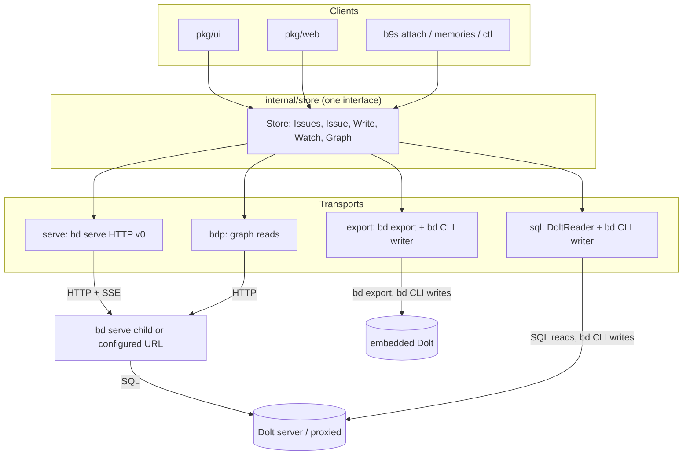
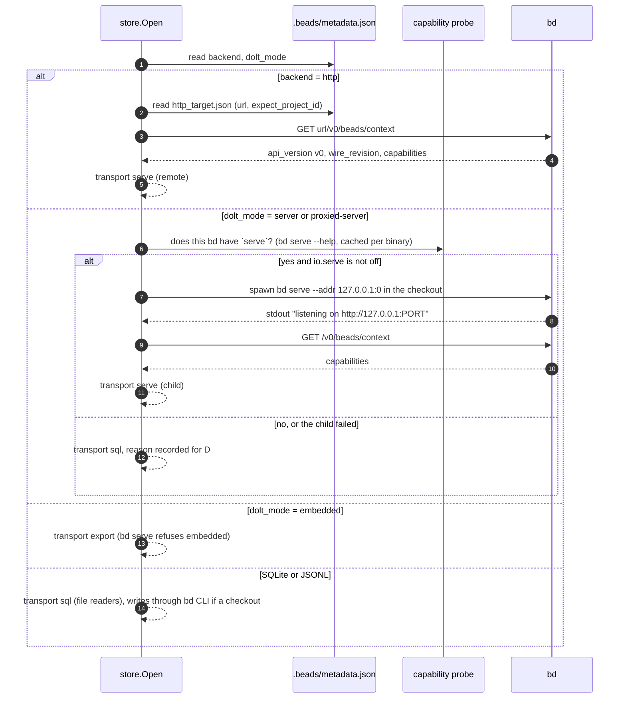
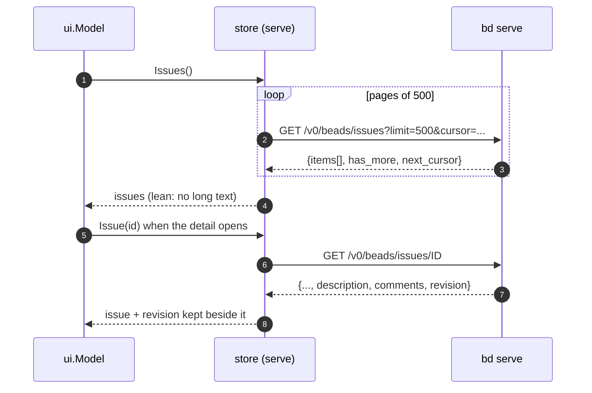
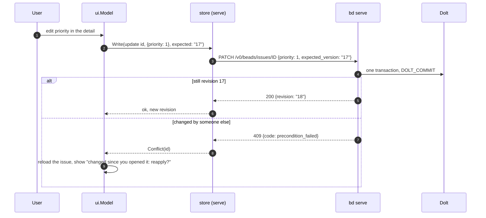
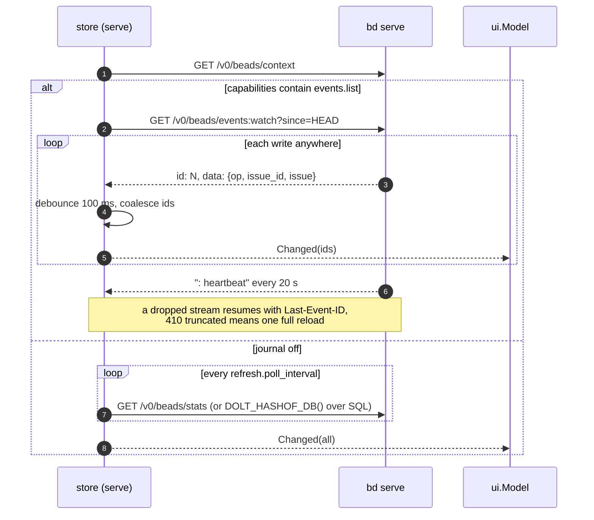
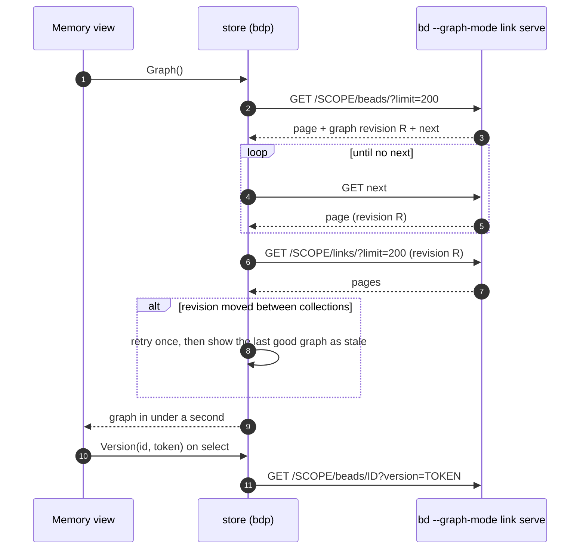

# Data IO target state: one transport layer for reads, writes and changes

Status: proposal, no task filed. Companion to [docs/data-io.md](../data-io.md),
which describes how reads and writes work today. This document describes where
they should end up, and in which order to get there.

## Contents

- [Goal](#goal)
- [Why change](#why-change)
- [Principles that stay](#principles-that-stay)
- [Target architecture](#target-architecture)
- [Choosing a transport per workspace](#choosing-a-transport-per-workspace)
- [Reads](#reads)
- [Writes](#writes)
- [Change detection](#change-detection)
- [The Memory graph over BDP](#the-memory-graph-over-bdp)
- [What stays the same](#what-stays-the-same)
- [Phases](#phases)
- [Risks and open questions](#risks-and-open-questions)
- [Non-goals](#non-goals)

## Goal

b9s talks to a Beads workspace through one `Store` interface with three
methods that matter: read, write, and watch. Behind it sit interchangeable
transports. Each workspace gets the best transport its `bd` and its storage
mode support, chosen once at open and shown in the `D` health popup. The TUI,
the web server and the `b9s` subcommands never know which one they got.

The preferred transport is `bd serve`'s HTTP API. It gives b9s what the current
mix of SQL and CLI cannot give at the same time:

- one process for every operation, instead of about 0.4 s of startup per
  write and per Memory read;
- compare-and-swap writes through `expected_version`, so b9s can refuse to
  overwrite a change it has not shown yet;
- a push change feed (`events:watch`) instead of polling a hash twice a second;
- the same rules on every write, because `bd` still performs it;
- one code path for the TUI, the web UI and a future remote (HTTP backend)
  checkout.

Direct SQL stays as the read transport where no `bd serve` can run, and the
`bd` CLI stays as the write transport for embedded workspaces, which `bd serve`
refuses.

## Why change

Today's shape works, but it has four seams that the newer `bd` closes:

| Seam today | Cost | What closes it |
|---|---|---|
| Every write is a new `bd` process | 0.4 s per action, 60 s deadlines, process-group kills | `bd serve` handles a write in one request |
| Reads and writes see the store differently (SQL vs. CLI) | Schema drift lands in `DoltReader` first, with a narrow-column fallback | `bd serve` returns `bd`'s own view of an issue |
| The UI cannot tell "nobody changed this" from "someone changed this since I loaded it" | Last writer wins on `bd update` | `revision` and `expected_version` (409 `precondition_failed`) |
| A checkout on the HTTP backend has no Dolt address | b9s cannot open it at all | Read `http_target.json` and use the same HTTP client |

The Memory graph has a fifth: a complete read takes 5 to 8 s through the
preview CLI, and BDP read the same graph in about 0.4 s
([memory-read-research.md](../memory-read-research.md)).

## Principles that stay

1. **b9s never writes to a store itself.** Every write is performed by `bd`,
   whether through its CLI or its HTTP API.
2. **b9s never holds an embedded store open.** Embedded workspaces keep the
   `bd export` reader and the fingerprint watcher
   ([ADR 0025](../adr/0025-read-embedded-dolt-through-bd-export.md)).
3. **The store is the source of truth.** After a write, the UI reloads what
   `bd` stored; it never patches its own copy.
4. **Credentials follow trust, not convenience.** `BEADS_DOLT_PASSWORD` goes
   only to trusted endpoints ([ADR 0013](../adr/0013-trust-dolt-endpoints-before-sending-environment-credentials.md)).
   A `bd serve` bearer token is read from the same places `bd` reads it, and
   sent only to the address it was issued for.
5. **Capability, not version.** A transport is chosen from what the workspace
   and the `bd` say they can do (`/v0/beads/context`, `metadata.json`,
   `bd --help` probes), never from a version number
   ([ADR 0045](../adr/0045-probe-bd-help-before-memory-reads.md)).
6. **Every wait is bounded, every fallback is explained.** A transport that
   fails to come up is reported in the health popup with its reason, and the
   next one down is used.

## Target architecture

The `Store` interface, in a new `internal/store` package, is the only thing
`pkg/ui` and `pkg/web` import for data. It carries today's reader methods
(`LoadIssues`, `GetIssueByID`, `AllComments`), the `IssueWriter` operations as
one `Write(op)` with an optional expected revision, a `Watch()` channel of
change events, and the Memory graph client. `internal/datasource` keeps
discovery and becomes the `sql` and `export` transports; `pkg/ui/issue_writer.go`
becomes the CLI writer those two transports share.

## Choosing a transport per workspace

Decisions in this flow:

- **b9s supervises its own `bd serve` child** for a local server or proxied
  workspace. `bd serve` writes no pid or port file, so there is nothing to
  discover; spawning is the only way to get one without asking the user to run
  it. The child runs in its own process group under the same `bdrun` rules as
  every `bd` call, listens on a free loopback port, needs no token, and is
  killed when the project closes or b9s exits. Two b9s instances on one
  workspace run two children; `bd serve` is built for that.
- **A configured URL wins over a child.** `io.serve_url` in `config.yaml`, or
  the HTTP backend's `http_target.json`, points b9s at a server somebody else
  runs. The bearer token comes from `BEADS_HTTP_TOKEN`, then
  `BEADS_HTTP_TOKEN_COMMAND`, then `bd`'s credentials file, the same ladder `bd
  connect` uses.
- **`B9S_IO=sql`** (and `io.transport: sql` in config) forces the old
  transport. The lever can only subtract, as `B9S_MEMORY=off` does
  ([ADR 0046](../adr/0046-memory-lever-keeps-graph-workspace-issues.md)).
- **The all-projects view (`0`)** stays on `MultiDoltReader` over SQL. It is
  read-only, spans databases, and one child per database would be waste.

## Reads

### Through `bd serve`

The list stays lean, as the web snapshot already is: long text and comments
arrive when a detail opens. That removes the "four separate reads" window that
the SQL reader has today, because each issue's detail is one consistent
response. The `revision` from the detail read is what the next write asserts.

### Through SQL (unchanged)

`DoltReader` and `MultiDoltReader` keep their queries. The narrow-column
fallback stays until every supported workspace can serve, and is then removed
rather than extended.

### Embedded (unchanged)

`bd export` on a fingerprint change, as ADR 0025 decides.

## Writes

- **Single-issue edits assert a revision.** Bulk actions on marks do not: the
  user asked for "close all these", and a concurrent edit to one of them is
  not a reason to stop. The confirmation lists the targets as it does today.
- **Batch verbs map to batch endpoints.** `bd close a b c` becomes
  `POST /v0/beads/issues:batchClose`, which the server commits once.
- **The CLI writer stays for `sql` and `export`** and keeps its deadlines.
  Behind the `Store` interface it is one more transport, so the TUI and the
  web write code lose their knowledge of `bd` arguments.
- **Attachments** keep the blob-then-comment order
  ([ADR 0024](../adr/0024-attach-files-through-reference-comments.md)); the
  comment goes through `POST /v0/beads/issues/ID/comments` when serving.

## Change detection

- The stream gives b9s the changed ids, so a reload can be partial: fetch
  those issues, keep the rest. The tree keeps cursor, marks and folds as it
  does for a full reload.
- The events journal is opt-in on the `bd` side. When it is off, b9s polls as
  today. The health popup says which mode is active, so a user who wants push
  updates knows to turn on `events-journal`.
- The watcher interface is the same channel for every transport, so
  `pkg/watcher` (JSONL), `DoltWatcher` (hash and fingerprint) and the SSE
  client are three implementations of one thing.

## The Memory graph over BDP

The preview CLI stays the reader until BDP ships with what
[ADR 0041](../adr/0041-retain-cli-memory-reads-after-transport-probes.md)
requires: a common snapshot or graph revision across the Bead and Link
collections, and a retained-version path. When it does, the graph client
becomes one more transport behind `Store.Graph()`.

Embedded graph workspaces cannot serve BDP, so they keep the CLI reader. The
capability probe decides, as it does today for the preview dialect.

## What stays the same

- `DiscoverSources` and `resolveDoltAddress`: files only, same precedence.
- The embedded path end to end: `bd export`, fingerprint watcher, CLI writes.
- `Checkout` as the gate on writing: a project opened from its database alone
  stays read-only, including over `bd serve`.
- The all-projects view, the catalog and the preview's SELECT-only account
  ([ADR 0007](../adr/0007-read-shared-beads-through-one-select-only-catalog-account.md)).
- `bdrun` as the one place that starts a `bd` process, now including the
  `serve` child.
- The web API: `pkg/web` keeps its endpoints and SSE; it calls `Store` instead
  of the readers and `IssueWriter` directly.

## Phases

Each phase ships on its own, behind the capability check, with the `sql`
transport as the fallback the whole way.

| Phase | Delivers | Proof |
|---|---|---|
| 1. `Store` interface | `internal/store` wrapping today's readers, `IssueWriter` and watchers. No behaviour change | Existing unit and E2E suites pass unchanged; `pkg/ui` and `pkg/web` import only `internal/store` |
| 2. `serve` child and reads | Spawn `bd serve` for server and proxied workspaces, read issues through it, SQL fallback with reason in `D` | E2E against a scratch server (`B9S_TEST_DOLT_SCRATCH_ADDR`) opens through `serve`; killing the child falls back to `sql` within one poll |
| 3. Writes with CAS | `Write` over HTTP, `expected_version` on single-issue edits, conflict dialog, batch endpoints | A test writes through `bd` CLI between load and save and sees the 409 path; bulk close of 50 issues is one request |
| 4. Change feed | `events:watch` when `events.list` is advertised, partial reloads, poll fallback | A write from a second `bd` appears in the TUI without a poll tick; a cut stream resumes from `Last-Event-ID` |
| 5. HTTP backend checkouts | Open a `backend: http` checkout through its `http_target.json` and token ladder | E2E against a `bd serve` with `--auth-token-file`; no token means a one-line reason, never a prompt |
| 6. BDP graph | Graph reads over BDP where a graph server exists and advertises a revision fence | The parity probes from `memory_read_research_test.go` pass against the shipped server; the CLI reader stays for embedded |
| 7. Retire | Remove the narrow-column SQL fallback and the per-process Memory inventory reads once no supported workspace needs them | Tests for the removed paths are deleted with them |

Phase 1 is a refactor and goes first because it is the only one with no
external dependency. Phases 2 to 4 depend on a released `bd` with the v0 API,
which `v1.3.1` has. Phase 5 waits for `bd connect` to ship. Phase 6 waits for
BDP collections with a revision fence.

## Risks and open questions

- **A `bd serve` child per b9s instance.** Each holds a pool of up to 20
  connections to the Dolt server. Ten open b9s windows on one shared server
  would be 200 connections. Mitigation: a child per workspace, shared between
  b9s instances through the control socket's registry
  ([ADR 0023](../adr/0023-steer-a-running-b9s-through-a-control-socket.md)),
  the last instance out stopping it. Decide after measuring.
- **Child lifetime after a crash.** `bd serve` has no idle timeout. A b9s
  killed with `SIGKILL` leaves its child running. Mitigation: the child is
  started with a parent-death signal where the platform has one, and
  `b9s ctl` lists and reaps orphans by the pid file b9s writes beside its own.
- **Lean lists hide long text from search.** Today the fuzzy search covers
  descriptions because the SQL reader loads them. Either `issues:query` serves
  the search, or the list fetch stays full. Measure the list size on the
  largest workspace before choosing.
- **The journal is opt-in.** Most workspaces will poll until their owner turns
  it on. The health popup should say so in one line, with the config key.
- **Proxied workspaces and `bd serve`.** The server unwraps the proxied
  provider and should work; the Gas City rigs are the place to prove it.
- **Wire revision drift.** b9s sends `Bd-Wire-Revision: 2`. A server below
  `min_client_wire_revision` refuses with `wire_revision_unsupported`; b9s
  falls back to `sql` and names the mismatch.
- **BDP is not released.** Phase 6 is contingent, and the retained-version
  path is still a 400 in the preview. Nothing in phases 1 to 5 depends on it.

## Non-goals

- Opening an embedded store in-process, or starting a `dolt sql-server` on
  one. ADR 0025 stands.
- A direct-SQL Memory reader. ADR 0041 stands.
- Writing through SQL under any circumstances.
- Replacing `bd` for anything but transport. Rules, hooks and history are
  `bd`'s.
