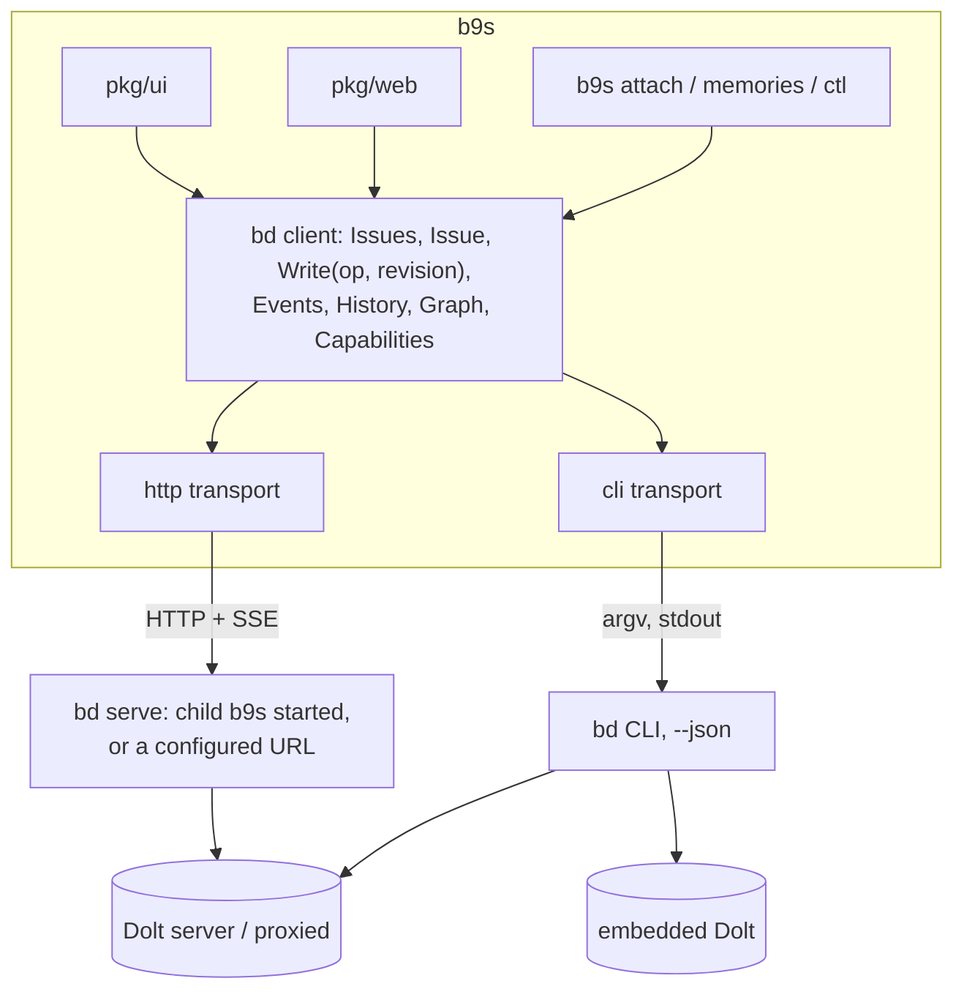
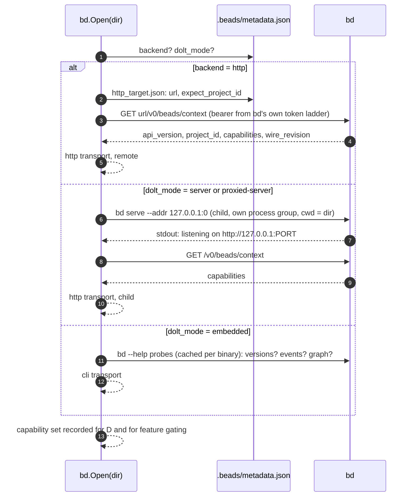
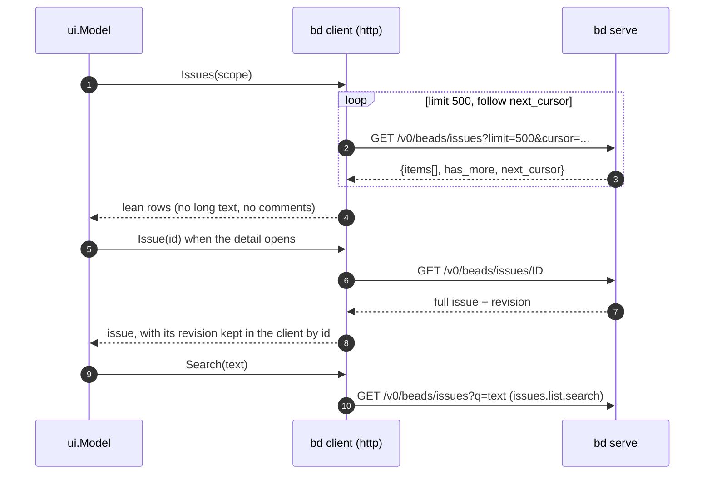
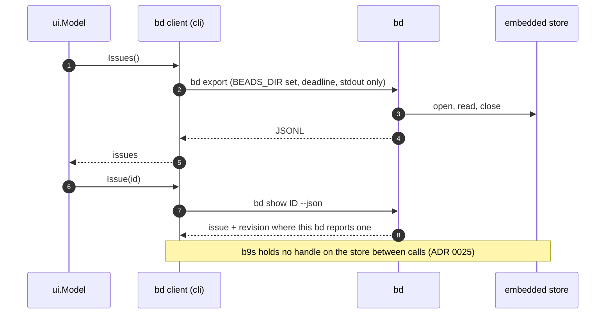
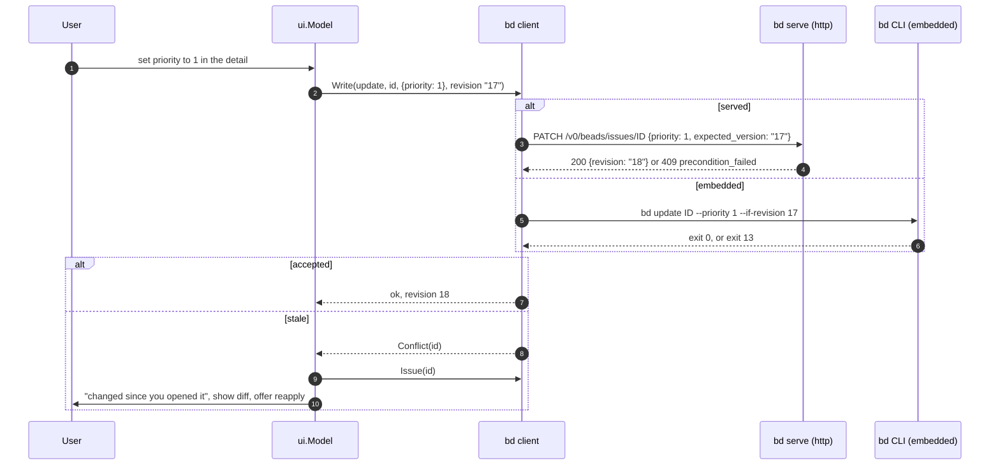
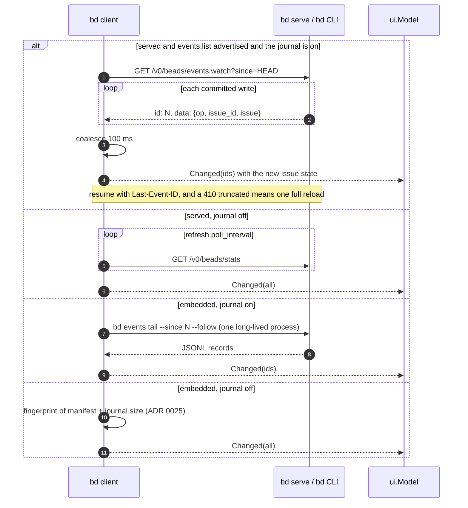
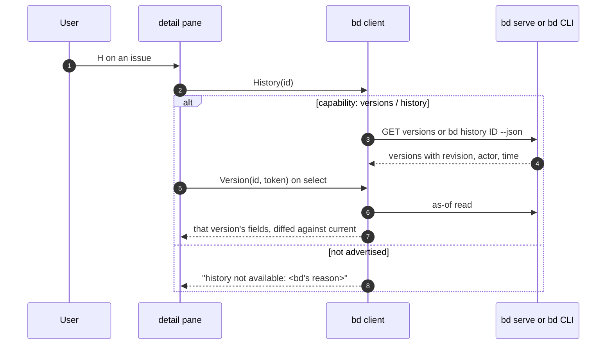
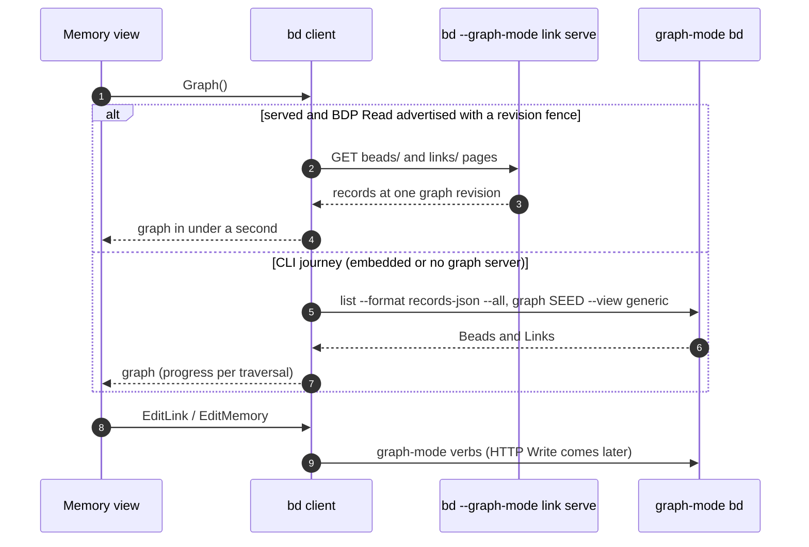

# Data IO target state: b9s as a bd client

Status: proposal, no task filed. Companion to [docs/data-io.md](../data-io.md),
which describes how reads and writes work today.

Beads is the given: `bd` at `v1.3.1` (2026-09-30), the `v1.3.2` release
candidates, what is on upstream `main` at `048f5e5`, and the
[1.4 roadmap](https://github.com/gastownhall/beads/blob/main/ROADMAP.md)
(versioned beads and history, Beads Graph Preview 2). b9s is the variable:
this document redesigns its IO around the boundaries Beads now offers,
without regard for how b9s is built today.

## Contents

- [What Beads offers a client](#what-beads-offers-a-client)
- [The decision: HTTP where served, CLI where not, never SQL](#the-decision-http-where-served-cli-where-not-never-sql)
- [Target architecture](#target-architecture)
- [Opening a workspace](#opening-a-workspace)
- [Reads](#reads)
- [Writes carry a revision](#writes-carry-a-revision)
- [Change detection](#change-detection)
- [History (roadmap: versioned beads)](#history-roadmap-versioned-beads)
- [Memory and Links (roadmap: Graph Preview 2)](#memory-and-links-roadmap-graph-preview-2)
- [What b9s stops doing](#what-b9s-stops-doing)
- [Phases](#phases)
- [Decisions for the owner](#decisions-for-the-owner)
- [Rejected: the Go SDK as the boundary](#rejected-the-go-sdk-as-the-boundary)
- [Risks](#risks)

## What Beads offers a client

Beads' [charter](https://github.com/gastownhall/beads/blob/main/engdocs/PROJECT_CHARTER.md)
says core exposes "stable issue data, metadata, CLI output, and documented
extension points", and that storage is Dolt's business, behind a boundary. A
client has three doors, and only three are supported:

| Door | What it is | Works on | Versioning | State |
|---|---|---|---|---|
| **CLI** | `bd ... --json`, `--format records-json`, `bd export`, `bd events tail` | Every mode: embedded, server, proxied, HTTP-backed | Help text; capability refusals name their token | Shipped, the stable surface |
| **HTTP API v0** | `bd serve`: `/v0/beads/...`, RFC 9457 problems, `capabilities[]`, `wire_revision`, SSE `events:watch` | Server and proxied workspaces only; refuses embedded | `GET /v0/beads/context` advertises every operation and parameter as a token | Shipped in 1.2.1, about 43 operations now |
| **Go SDK** | `beads.OpenFromConfig`, `OpenBestAvailableWith`, `backend/`, `memoryops/` | Every mode, in-process | "EXPERIMENTAL. Pin an exact beads version" | Shipped, for backends and embedders |

Two things the current `bd` adds on top of all three doors:

- **Revisions.** Every issue has an opaque `revision`. A write may assert it:
  `expected_version` over HTTP (409 `precondition_failed`), `--if-revision`
  on the CLI (exit 13) for `update`, `close`, `claim`, `release` and, on
  `main`, `reopen`. Roadmap 1.4 extends this into full history: every change
  recorded as a version, `expectedRevision` CAS everywhere, as-of reads.
- **The events journal.** Opt-in (`events-journal: true`). One record per
  committed mutation, in the same transaction, carrying the resulting state.
  Read by sequence over HTTP (`/events`, `/events:watch`) or the CLI
  (`bd events tail --since N --follow`).

And the direction of travel: `bd` itself is becoming an HTTP client of
`bd serve` (`bd connect`, the `http` backend, on `main`), the SDK grows
embedder hooks (`OpenWith`, per-open credentials), and Graph Preview 2 ships
the Bead-and-Link graph through the CLI first, BDP Read second, HTTP Write
last.

## The decision: HTTP where served, CLI where not, never SQL

**b9s becomes a client of `bd`. It speaks the HTTP API to a `bd serve` when
one can exist, and runs the `bd` CLI when one cannot. It never opens a Dolt
connection and never parses a store.**

Why this pair, and not something else:

- **Embedded is `bd init`'s default and `bd serve` refuses it.** A boundary
  that excludes embedded excludes most new users. The CLI is the only
  supported door there, so b9s keeps a CLI transport.
- **A server workspace deserves better than one process per action.** The
  HTTP API gives one long-lived connection, CAS, a push change feed, batch
  endpoints, and capability tokens that let b9s and `bd` move at different
  speeds. The CLI's `--watch` and `events tail --follow` poll once a second
  and start a process per call.
- **Direct SQL is the door Beads does not offer.** It is why b9s carries a
  schema-fallback query, an address-resolution ladder, a proxy pid-file
  reader and a password-trust list. Every one of those re-implements
  something `bd` already does. Dropping SQL removes them all.
- **The SDK couples the b9s binary to one `bd` version** and brings the Dolt
  engine into it. See [Rejected](#rejected-the-go-sdk-as-the-boundary).

With one `Client` interface over the two transports, every b9s feature is
written once. Where a transport cannot do something, the client says so with
`bd`'s own reason.

## Target architecture

`internal/bd` is the only package that knows how to reach a workspace. It
owns both transports, the capability model, the `bd serve` child and the
revision bookkeeping. `pkg/ui`, `pkg/web` and the subcommands import it and
nothing else for data.

## Opening a workspace

- b9s reads `metadata.json` for one field pair, `backend` and `dolt_mode`,
  to pick a transport. It no longer resolves a Dolt address, a proxy root or
  a port file: `bd serve` and the `bd` CLI do that themselves.
- **b9s supervises its own `bd serve` child** for a local server or proxied
  workspace. `bd serve` writes no pid or port file, so starting one is the
  only way to have one without asking the user. The child needs no token on
  loopback, is killed with its process group when the project closes, and is
  reported in `D` with its port. A configured `io.serve_url` in `config.yaml`
  takes precedence, for a server somebody else runs.
- Capability is read from `/v0/beads/context` over HTTP and from `--help`
  probes on the CLI, never from a version string
  ([ADR 0045](../adr/0045-probe-bd-help-before-memory-reads.md)). Every b9s
  feature declares the tokens or verbs it needs; a missing one turns the
  feature off with a one-line reason, as `M` does today.
- The lever `B9S_IO=cli` forces the CLI transport for a served workspace. It
  can only subtract.

## Reads

### Over HTTP

The list is lean, as the web snapshot already is. Fuzzy search over titles and
ids stays local; description search goes to the server where
`issues.list.search` is advertised, and is otherwise off with a reason.

### Over the CLI (embedded)

## Writes carry a revision

Every single-issue edit asserts the revision the user saw. Bulk actions on
marks do not: "close all of these" is the instruction, and a concurrent edit
to one of them is not a reason to stop. The confirmation lists the targets as
today.

- Bulk verbs use batch endpoints over HTTP (`issues:batchClose`,
  `issues:batchApply` up to 1000 items) and one `bd` call with all ids on the
  CLI, as today.
- Attachments keep the blob-then-comment order
  ([ADR 0024](../adr/0024-attach-files-through-reference-comments.md)); the
  comment goes through `POST /v0/beads/issues/ID/comments` or
  `bd comments add`.
- `b9s` never bypasses a refusal. A 409 `not_closable` with its `blockers`,
  or `bd close`'s non-zero exit, is shown with `bd`'s text.

## Change detection

The event record carries the resulting issue, so a change arrives with its
data: b9s updates that row and keeps the rest, cursor, marks and folds
included. The health popup names the active mode and, when polling, the
`events-journal` key that would turn on push.

## History (roadmap: versioned beads)

Roadmap 1.4 records every change as a version, behind a flag, with as-of
reads and `bd history`. b9s adds a history pane that reads whatever the
workspace's `bd` can answer:

The pane is built against the preview's `bd versions` and `bd show --version`
today, and switches to the upstream surface by capability when 1.4 names it.
Nothing in b9s depends on the flag's name.

## Memory and Links (roadmap: Graph Preview 2)

Preview 2 ships the graph through the installed CLI on embedded and
shared-server Dolt first, BDP Read behind `bd --graph-mode link serve`
second, and HTTP Write after the CLI journey is complete. b9s follows that
order:

The two transports already exist in spirit: the CLI journey is today's
`GraphPreviewClient`, and the BDP leg is what
[the transport investigation](../memory-read-research.md) measured.
[ADR 0041](../adr/0041-retain-cli-memory-reads-after-transport-probes.md)'s
conditions for the BDP leg stand: a common snapshot across the two
collections and a retained-version path.

## What b9s stops doing

| Removed | Replaced by |
|---|---|
| `DoltReader`, `MultiDoltReader`, the 22-column query and its narrow fallback | `GET /v0/beads/issues`, `bd export` |
| `resolveDoltAddress`, `proxied_server.go`, the port-file and `proxy.pid` readers | `bd serve` and `bd` resolve their own store |
| `BEADS_DOLT_PASSWORD` handling, `B9S_TRUSTED_DOLT_ENDPOINTS` ([ADR 0013](../adr/0013-trust-dolt-endpoints-before-sending-environment-credentials.md)) | No SQL credential in b9s. HTTP bearer tokens come from `bd`'s own ladder |
| `DoltWatcher` hash polling | `events:watch`, `bd events tail --follow`, or `/stats` polling |
| `IssueWriter`'s per-verb argument building in `pkg/ui` | `bd client.Write(op)` in `internal/bd`, with the CLI argv in one table |
| `go-sql-driver/mysql` | Removed from `go.mod` |
| SQLite and JSONL as live sources | **Decision below** |

The embedded path keeps `bd export`, the fingerprint watcher and
[ADR 0025](../adr/0025-read-embedded-dolt-through-bd-export.md) unchanged.
`internal/bdrun` stays as the one place that starts a `bd` process, now
including the `serve` child and the `events tail` follower.

## Phases

Each phase ships behind the capability check, with the previous transport as
the fallback until the retire phase.

| Phase | Delivers | Proof |
|---|---|---|
| 1. `internal/bd` | The `Client` interface and the CLI transport, wrapping today's `bd export` reader, `IssueWriter` and fingerprint watcher. No behaviour change | Existing suites pass; `pkg/ui` and `pkg/web` import only `internal/bd` for data |
| 2. HTTP transport | `bd serve` child for server and proxied workspaces, reads over HTTP, `D` shows the transport | E2E on the scratch server opens through HTTP; killing the child reports and reopens |
| 3. Revisions | Single-issue edits assert `expected_version` / `--if-revision`, conflict flow, batch endpoints | A `bd` write between load and save produces the conflict dialog on both transports |
| 4. Change feed | `events:watch` and `bd events tail --follow` when the journal is on, partial row updates | A write from a second `bd` appears without a poll tick; a cut stream resumes |
| 5. History pane | `H` reads versions where advertised | Against the preview `bd` today; against upstream 1.4 when it ships |
| 6. Remote workspaces | Open a `backend: http` checkout through `http_target.json` and the token ladder | E2E against `bd serve --auth-token-file` |
| 7. BDP graph leg | Graph reads over BDP when a graph server advertises a fence | The parity probes pass against the shipped server |
| 8. Retire SQL | Delete the SQL readers, address resolution, watcher and the MySQL driver | Tests go with the code; `go mod tidy` drops the driver |

Phases 1 to 4 need only `bd v1.3.1`. Phase 6 waits for `bd connect` to be
released. Phases 5 and 7 track the two roadmap areas and are built against
the preview builds until then. Phase 8 waits until every supported workspace
opens through phases 2 or 1.

## Decisions for the owner

1. **SQLite and JSONL as live sources.** Beads' supported paths are embedded
   Dolt, Dolt server and (per its changelog) SQLite; JSONL is the export and
   import format. Proposal: b9s stops reading `beads.db` and `issues.jsonl`
   as projects, and keeps JSONL as a test fixture format and for
   `git`-history views. Users on those files run `bd import` once.
2. **The all-projects view (`0`).** Today it is `MultiDoltReader` over a
   SELECT-only catalog account ([ADR 0007](../adr/0007-read-shared-beads-through-one-select-only-catalog-account.md)).
   Without SQL it becomes a list of workspaces, each opened through its own
   transport, with one `bd serve` child per server workspace. Proposal: keep
   the view, source it from `config.yaml`'s recent projects, and accept one
   child per workspace. The Kubernetes preview's read-only catalog needs a
   `bd serve` per database, started by the preview, with a read-only token.
3. **One `bd serve` child per b9s instance or per workspace.** Per instance
   is simplest. Sharing through the control socket registry
   ([ADR 0023](../adr/0023-steer-a-running-b9s-through-a-control-socket.md))
   saves Dolt connections when many windows open one workspace. Proposal:
   per instance first, measure, then share if a shared server shows strain.
4. **Go toolchain.** None of this needs the Beads module, so b9s stays on
   its own Go version.

## Rejected: the Go SDK as the boundary

Importing `github.com/steveyegge/beads` would give one in-process door to
every mode, embedded included, and the HTTP backend inside it. It was
rejected because:

- The SDK calls itself experimental and asks embedders to "pin an exact beads
  version and re-run the conformance suite on every bump". A user upgrades
  `bd` on their own schedule; a b9s pinned to an older beads refuses a
  workspace the newer `bd` migrated (the migration gate fails closed), and a
  b9s pinned to a newer one would migrate a shared server under other
  clients unless told not to.
- It pulls the Dolt engine into the b9s binary and requires the Beads
  module's Go toolchain (1.26.5 today, against b9s's 1.25).
- Holding an embedded store open from a long-lived process blocks the user's
  own `bd` writes; opening per operation is what `bd export` already does
  from outside the binary.
- The capability model of the HTTP API (tokens, `wire_revision`,
  `min_client_wire_revision`) is built for exactly the independent-release
  relationship b9s has with `bd`. The SDK offers no equivalent.

Reconsider if Beads declares the SDK stable with a compatibility promise
across minor versions, or ships `bd serve` for embedded workspaces, which
would remove the CLI transport's reason to exist.

## Risks

- **The journal is opt-in.** Most workspaces will poll until the owner sets
  `events-journal: true`, and it must be on for every writer, including the
  `bd serve` child. b9s can start its child with `BD_EVENTS_JOURNAL=1`, but
  writes from other `bd` processes still need the config key. The health
  popup says so.
- **Orphaned children.** `bd serve` has no idle timeout. A `SIGKILL`ed b9s
  leaves one running. Mitigation: a parent-death signal where the platform
  has one, a pid file beside b9s's own control registration, and `b9s ctl`
  reaping children whose b9s is gone.
- **Lean lists and local search.** Fuzzy search over descriptions moves to
  the server (`issues.list.search`) or is dropped. Measure the largest
  workspace's list payload before choosing full rows.
- **Wire revision drift.** b9s sends `Bd-Wire-Revision` for the revision it
  was built against. A server below its `min_client_wire_revision` refuses
  with `wire_revision_unsupported`; b9s shows the mismatch and offers the CLI
  transport.
- **Revision on the CLI.** `--if-revision` and the `revision` field in
  `bd show --json` are recent; an older `bd` has neither. The client treats a
  missing revision as "no CAS available", never as "matches".
- **Graph Preview 2 is unreleased.** Phases 5 and 7 are built against preview
  binaries and gated by capability, so a different final shape costs a
  parser, not a design.
