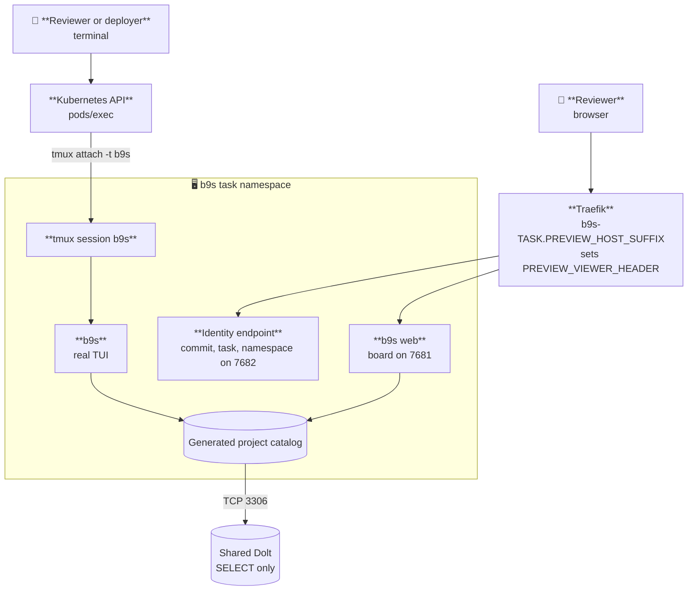

# Browser-accessible Kubernetes previews

The b9s preview serves `b9s web` at its URL and runs the real terminal UI in a
tmux session inside the Pod. A reviewer opens the board in a browser and
attaches to the terminal UI with `kubectl exec`, so the TUI is tested in a real
terminal (ADR 0058). The preview reads every accessible Beads database through a
database-enforced SELECT-only account. It does not seed fixture tickets or hold
a write-capable Beads credential.

Status: active

## Contents

- [Interface](#interface)
- [Deployment values](#deployment-values)
- [Runtime shape](#runtime-shape)
- [Terminal UI access](#terminal-ui-access)
- [Web board access](#web-board-access)
- [Namespace and access boundary](#namespace-and-access-boundary)
- [Image delivery](#image-delivery)
- [Clickable URL](#clickable-url)
- [Ingress access](#ingress-access)
- [Configuration](#configuration)
- [Local verification](#local-verification)
- [Cleanup](#cleanup)

## Interface

The deployment verifier uses five repository-owned commands:

```text
scripts/preview/preview-build   TASK_ID COMMIT_SHA
scripts/preview/preview-deploy  TASK_ID COMMIT_SHA
scripts/preview/preview-status  TASK_ID COMMIT_SHA
scripts/preview/preview-verify  TASK_ID COMMIT_SHA
scripts/preview/preview-destroy TASK_ID COMMIT_SHA
```

Every command requires a full lowercase commit SHA and refuses a different HEAD
or uncommitted source changes. The only worktree exceptions are untracked
`.codex-tmp/` harness files, an unstaged modification of `.beads/.local_version`
(Beads' local upgrade-notification state), and an untracked `.beads.gate.lock`
(the local Beads coordination lock). These artifacts remain in place and are
excluded from the preview image build context by `Dockerfile.dockerignore`.
Staged changes, Beads issue/configuration edits, and other untracked files still
block delivery. Do not reset, delete, or hide files to satisfy the guard.

The default kubeconfig is `/mnt/secrets/preview/preview.kubeconfig`, a
project-scoped credential the cluster mounts into the deploying Pod. The
default context is `preview`.

## Deployment values

This repository does not know the cluster it deploys to. Every value that names
a platform object comes from the environment, supplied by whatever runs the
preview (a software factory, or an operator's shell). The commands stop before
any cluster access when a required value is missing.

| Variable | Required | Meaning |
| --- | --- | --- |
| `PREVIEW_HOST_SUFFIX` | yes | DNS suffix of preview hosts |
| `PREVIEW_INGRESS_MIDDLEWARE` | no | Comma-separated Traefik Middleware references (`namespace-name@kubernetescrd`) on every preview Ingress, in the order Traefik applies them; empty renders none |
| `PREVIEW_LABEL_DOMAIN` | yes | Prefix of the namespace labels the cluster's policies match |
| `PREVIEW_RUNNER_NAMESPACE` | yes | Namespace whose Pods may reach the preview |
| `PREVIEW_WORKLOAD_ROLE` | yes | ClusterRole bound inside the preview namespace |
| `PREVIEW_DEPLOYER_SA` | yes | `namespace/name` of the deploying ServiceAccount |
| `PREVIEW_READER_REF` | yes | Name of the Secret holding the read-only database credential |
| `PREVIEW_VIEWER_HEADER` | yes | Request header the ingress sets to the viewer's identity, which `b9s web --trust-header` reads |
| `PREVIEW_VIEWER` | yes | Email address the board accepts in that header, passed as `b9s web --owner` |

`PREVIEW_DEPLOYER_SA` and `PREVIEW_READER_REF` may contain `{project}`, which
the scripts replace with `b9s`. A cluster that serves several projects can then
set one template for all of them.

## Runtime shape



The image bakes `/app/.commit-sha`. Deployment supplies only the task and
namespace, so an edited environment variable cannot make one image claim to be
another commit. `preview-verify` reads `/__preview` through the Service and
compares all three identity fields with the requested preview.

The web process runs with `--projects-root /data/projects --discover-dolt`.
Project-list and project-open requests refresh readable Beads databases through
the same SELECT-only account. Discovery creates only local checkout metadata,
adds newly readable projects, and drops projects whose database disappears or
denies reads. Transient discovery failures retain the last list. It requires
no pod restart, so the running server retains its CSRF value. Discovery does
not grant database access or enable shared Dolt writes. The identity endpoint
continues to report the image's baked commit, task and namespace.

## Terminal UI access

The TUI starts in a detached tmux session named `b9s` and opens the all-projects
view. Attach to it with the namespace's credential:

```sh
kubectl -n b9s-TASK-SLUG exec -it deploy/b9s -- tmux attach -t b9s
```

Detach with `Ctrl-b d`. The session keeps running, so a second viewer attaching
later sees the same screen. The browser URL never serves a terminal.

To start a separate TUI, use the image's wrapper:

```sh
kubectl -n b9s-TASK-SLUG exec -it deploy/b9s -- preview-tui
```

The wrapper uses the project selected during startup, preferring `b9s` when
available. It sets the terminal, home directory, browser suppression and Dolt
environment inside the Pod. The password stays inside the Pod. Quit this TUI
with `q`. Both commands require a terminal and `pods/exec` access.

## Web board access

`b9s web` runs in trust-header mode (ADR 0021). It answers only a request whose
`PREVIEW_VIEWER_HEADER` equals `PREVIEW_VIEWER`, so the cluster's ingress must
set that header on every request and replace any copy a client sent. Without
the header the board answers 401. `preview-verify` sets the header itself when
it reaches the Service from inside the cluster.

## Namespace and access boundary

`TASK_ID` becomes `b9s-TASK-SLUG`. The namespace carries these labels, with
`PREVIEW_LABEL_DOMAIN` as the prefix:

```text
PREVIEW_LABEL_DOMAIN/preview=true
PREVIEW_LABEL_DOMAIN/project=b9s
PREVIEW_LABEL_DOMAIN/task-id=TASK_ID
PREVIEW_LABEL_DOMAIN/commit-sha=COMMIT_SHA
```

The deployer is expected to hold only namespace lifecycle and constrained bind
permissions. The first namespaced object is a RoleBinding of
`PREVIEW_DEPLOYER_SA` to `PREVIEW_WORKLOAD_ROLE`. The cluster's admission policy
decides where that binding is allowed. LimitRange, ResourceQuota and
NetworkPolicy ship with every preview.

The credential is project-scoped, not lane-scoped. One b9s lane can still reach
another b9s lane's preview. It cannot bind or deploy in a sibling project's
namespace or in `default`.

Redeploying the same task with another SHA updates the namespace's
`commit-sha` label and kubectl's
`kubectl.kubernetes.io/last-applied-configuration` annotation. The cluster's
policy must allow these metadata updates in labelled `b9s-*` preview
namespaces. Namespace creation permission alone is insufficient. This
repository does not widen that policy.

`preview-deploy` first applies the rendered Namespace with `--dry-run=server`.
An admission or authorization failure stops before any workload is applied and
records the API error in `namespace-policy.log` in the evidence directory.
This catches metadata policy regressions even when the existing namespaced
RoleBinding still allows workload changes. The preflight does not grant access
or make the subsequent multi-resource apply atomic.

The `PREVIEW_READER_REF` Secret belongs to the cluster, not to the lane. A
cluster may place it in each preview namespace by itself; on one that does not,
an operator runs `scripts/preview/preview-provision-reader TASK_ID` once per
task. A lane never creates the Secret and never waits for it before deploying:
it runs `preview-deploy`, and if the Secret is absent the bounded rollout
fails and that failure is the report. Do not block in advance because the
Secret cannot be seen, since a lane has no permission to read it.

`preview-provision-reader` finds databases
that contain an `issues` table, grants the read-only identity named by
`BEADS_DOLT_READ_USER` `SELECT` on each database individually, proves a no-op
`UPDATE` is denied, and only then writes the `PREVIEW_READER_REF` Secret into
the task namespace. Database names are enumerated because Dolt does not
reliably enforce wildcard database grants. Re-run the command after adding a
Beads database.

The Secret exposes only `B9S_DOLT_HOST`, `B9S_DOLT_PORT`,
`B9S_DOLT_READ_USER`, and `B9S_DOLT_READ_PASSWORD`. The NetworkPolicy permits
database traffic only on TCP 3306.

## Image delivery

Inside a runner Pod, `preview-build` uses the BuildKit service and pushes the
immutable SHA tag to the in-cluster registry:

```text
registry.registry.svc.cluster.local:5000/b9s-preview:COMMIT_SHA
```

On a workstation it uses Docker. Set `B9S_PREVIEW_PUSH_REGISTRY` when the
registry is reached through a local port-forward but the cluster must pull the
service-name image reference.

## Clickable URL

The URL is:

```text
http://b9s-TASK-SLUG.PREVIEW_HOST_SUFFIX:B9S_PREVIEW_INGRESS_PORT
```

Use a suffix under a domain you resolve yourself, such as a reserved `.test`
name answered by a local resolver. Do not use nip.io or sslip.io: a label
ending in digits can be read as part of the embedded address and route to an
unrelated public IP.

## Ingress access

The board trusts a request header, so whoever can reach the ingress route can
act as the viewer. On a cluster whose ingress is publicly reachable, list in
`PREVIEW_INGRESS_MIDDLEWARE` a Middleware that admits only trusted traffic and
one that sets the viewer header, and have admission refuse a preview Ingress
without the first.
How a reviewer then reaches the preview (a port-forward, a VPN) is the
cluster operator's choice and is documented with the cluster, not here.

Traefik answers 404 for a route that names a Middleware the cluster does not
define. Leave the variable empty on a cluster without one.

## Configuration

Tuning knobs, all optional:

| Variable | Default | Purpose |
| --- | --- | --- |
| `B9S_PREVIEW_KUBECONFIG` | `/mnt/secrets/preview/preview.kubeconfig` | Project-scoped credential |
| `B9S_PREVIEW_CONTEXT` | `preview` | Explicit kubectl context |
| `B9S_PREVIEW_REGISTRY` | `registry.registry.svc.cluster.local:5000` | Image reference used by Kubernetes |
| `B9S_PREVIEW_PUSH_REGISTRY` | same as registry | Docker push endpoint |
| `B9S_PREVIEW_BUILDKIT_ADDR` | `tcp://buildkitd.buildkit.svc.cluster.local:1234` | Unprivileged in-cluster builder |
| `B9S_PREVIEW_INGRESS_PORT` | `8081` | Local Traefik host port |
| `B9S_PREVIEW_ROLLOUT_TIMEOUT` | `180` | Bounded rollout wait in seconds |
| `B9S_PREVIEW_DELETE_TIMEOUT` | `180` | Bounded namespace deletion wait in seconds |

`preview-provision-reader` reads `B9S_PREVIEW_ADMIN_KUBECONFIG` (default
`KUBECONFIG`), the required `B9S_PREVIEW_ADMIN_CONTEXT`, `BEADS_DOLT_READ_USER`
and `BEADS_DOLT_ROOT_PASSWORD`.

## Local verification

Use an admin kubeconfig only for operator testing. A lane uses the mounted
project kubeconfig instead.

```sh
sha="$(git rev-parse HEAD)"
export B9S_PREVIEW_KUBECONFIG="$HOME/.kube/config-local"
export B9S_PREVIEW_CONTEXT=local
# plus the PREVIEW_* values from "Deployment values"

scripts/preview/preview-provision-reader bd-b6jw
scripts/preview/preview-build bd-b6jw "$sha"
scripts/preview/preview-deploy bd-b6jw "$sha"
scripts/preview/preview-verify bd-b6jw "$sha"
scripts/preview/preview-status bd-b6jw "$sha"
```

The contract tests use disposable local Git repositories and placeholder
deployment values, and do not call an image builder or the cluster. They
require Bash, Git, and GNU `timeout` (`gtimeout` is also accepted), with a
five-second deadline for each boundary check:

```sh
tests/preview_contract_test.sh
bash tests/preview_tui_test.sh
```

The TUI wrapper test additionally requires Docker and `alpine:3.22`. It runs
with networking disabled and checks the environment, selected project,
argument handling, exit status and missing prerequisites in an isolated container.
Pass an image tag and its expected baked identity to also run the installed
wrapper and real TUI as the unprivileged preview user, using a local JSONL
fixture and a 15-second deadline:

```sh
bash tests/preview_tui_test.sh IMAGE_TAG EXPECTED_COMMIT_SHA
```

The contract test simulates two deployments of the same task with different SHAs and a
namespace metadata denial, asserting that denial leaves workloads untouched,
and checks that each required deployment value stops the commands when
missing. For live verification, use the scoped kubeconfig for both SHAs, check
the namespace label and last-applied annotation, and verify the image's served
identity after each rollout. Use server-side dry-run metadata patches to prove
that `default` and an outside-prefix namespace are denied. Do not substitute
`kubectl auth can-i` for admission testing: RBAC permission alone does not
evaluate the namespace policy. A lane cannot read or provision the reader
Secret; a missing one shows up as a failed rollout, not as a precondition.

`preview-verify` checks the served identity, asks the board for `/api/session`
with the viewer header, and reads the tmux pane through `kubectl exec`, so a
preview passes only when the board and the terminal UI both run.

## Cleanup

`preview-destroy` derives exactly one namespace from the task ID, then checks
the project and task labels before deletion. It never uses a wildcard, label
selector, or `--all`.

```sh
scripts/preview/preview-destroy bd-b6jw "$sha"
```
