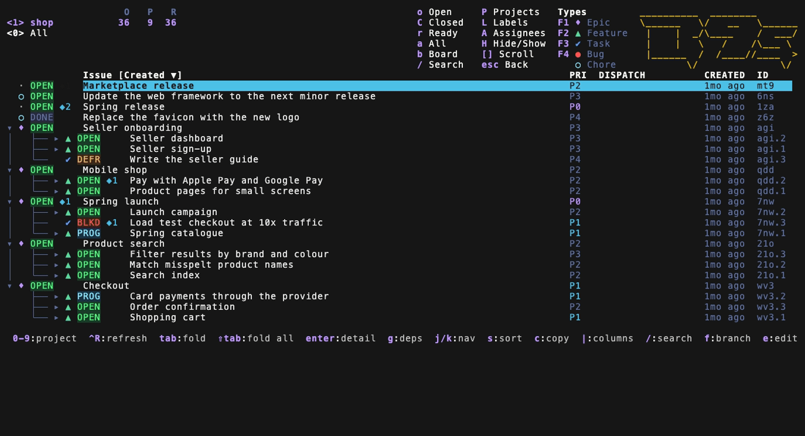
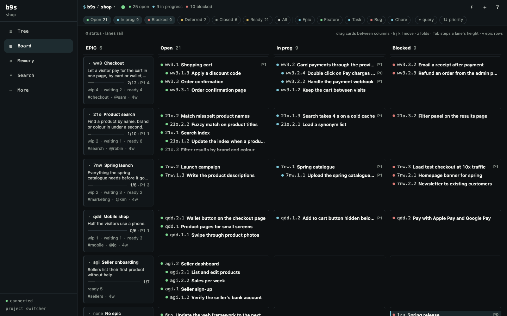

<!--
Release notes for v1.3.5, published as the body of the GitHub release.
Covers every commit from v1.3.4 to v1.3.5, including the November release candidate
(PRs #31 to #38), PRs #43 to #51 and PRs #46, #47, #52 to #56.
GoReleaser appends the "## Changelog" section when the release is built, so it is not written here.
The walkthrough video is docs/videos/release-2026-11--main.mp4.
The GIFs and the screenshot are in docs/releases/v1.3.5/ and are linked at the v1.3.5 tag.
The TUI GIFs are recorded with vhs on examples/sample-project.
-->

## Highlights

### b9s starts in four seconds instead of ten

A b9s that talks to Dolt through a tunnel spent most of its start waiting for a full read of every issue. It now reads the open issues and the epics first, draws them, and reads the rest right after. The queries of that first read run in parallel, and the Dolt watcher connects while it runs. Through the tunnel, the median time from start to the first issue on screen fell from 10.6 s to 4.1 s. A project switch takes the same path.

### Reloads that never freeze the keyboard

A reload behind a slow tunnel used to take seconds and block every key while it ran. It now runs beside the UI: one read at a time, changes that arrive meanwhile fold into one follow-up read, a reply for a project you already left is dropped, and a read gives up after 60 s. The footer says `reloading` while one runs.

Most reloads are also much smaller. b9s asks the server which issues changed since its last read, through their update times and new comments and dependencies, and reads only those (ADR 0062). A full read still runs on the first reload, after a failure, on `Ctrl-R` or `F5`, after 20 small reads, five minutes after the last full read, and when more than 500 issues changed.

When you leave b9s alone it polls less: every 500 ms while you use it, every 5 s after two minutes without input or while the terminal has no focus (`idle_poll_interval`), and every 30 s after fifteen minutes. The first key or click wakes it, so that keypress already sees fresh data (ADR 0061). `b9s web` keeps its fixed interval.

### Find without hiding anything

`/` still filters, as in a k9s table. `Ctrl-F` switches the same query to **find**, and with no query it opens the field in find mode, so you type the query straight after it: no issue is hidden, matches in the tree are underlined in orange, and `n` and `N` step through them. Occur, which shows only matching rows, moves from `Ctrl-O` to `&`, the key `less` uses for the same thing.

While you type a query, `Up` and `Down` recall the queries you submitted before, without moving the selection. `Down` past the newest one brings back your draft. b9s keeps the last 100. (#26)

### Step down the parent path with `f`

In the tree, the first `f` limits the view to the root epic of the selected issue. Each further press narrows to the next parent on the path down to it, and the press after the lowest one shows the whole tree again. `f`, `:branch` and the `branch` command now write `branch:<id>`, which matches one exact id, so `doc-25s.2` no longer pulls in `doc-25s.2.1` from under a sibling feature (ADR 0056).

### Priority in the tree, dispatch state where you look

The tree shows a **Priority** column by default, and the column selector can hide it. Lane state is now a column you pick from the selector, rather than one that appears on its own. The column choices you make are saved in your user config, and b9s keeps the rest of that file, comments included.

Issues that a harness such as Omnigent dispatched show their stage (`RUNNING`, `BLOCKED`, `DELIVERED`, `ABANDONED`) in the tree and on the board, read from the `dispatch:` labels.

### Due and defer dates in the detail

The detail pane shows an issue's due date and its defer-until date in your local time zone, in the terminal, in `b9s web` and in the Markdown that `y` copies.

### Comments newest first

Comments are listed newest first, and the order can be switched in the detail.

### Web: type chips and a Tree tab that toggles

The web filter row has **Epic**, **Feature**, **Task**, **Bug** and **Chore** chips. A chip replaces the `type:` terms in the query and keeps the rest, the same as the terminal. Tapping the only selected chip clears it. (#28)

Tapping **Tree** while the tree is already on screen switches to the flat list and back, as `t` does, and the tab reads **List** in list mode (ADR 0027).

### Forget a recent project with `:forget N`

An unreachable entry in the header used to slow every count refresh, and removing it meant editing the config file. `:forget N` removes the inactive project on header key `N` without connecting to its server. It respects `lock_recent`, never forgets the project you are in, and keeps the rest of your config file. (#53)

### Web: a board you can scan

Ordinary Open and In Progress cards on the web board are one-line rows with status, short ID, title and urgent priority. Rows are 24 px high on a desktop and keep 44 px touch targets on phones and tablets. Epic summaries keep their full content, and the detail still shows everything (ADR 0065). (#46, #55)

## Fixes

- **Projects:** switching projects no longer writes the new project's folds and bookmarks into the previous project's state file, and a Dolt-only project without a JSONL export keeps its tree state too. (#31)
- **Keys:** view keys and picker input reach their handlers again. `Alt+b` bookmarks, `B` cycles bookmarks, `b` opens the board, and `t` selects the flat list. `Esc` closes popups, occur, XRay, the query and the filters in that order. Text you type in the label and project pickers wins over global shortcuts. (#38)
- **Detail:** under a label filter, edit, close and delete act on the issue the detail shows, never on another row. (#38)
- **Web:** after a server restart, an open tab refreshes its session and replays the write once, instead of failing with `403 missing or wrong X-B9s-CSRF header` until you reload. (#35)
- **Web:** a hosted board finds Beads databases created or granted after it started, and drops ones it can no longer read. (#36)
- **Web:** closing an issue with a comment adds the comment, then closes the issue.
- **Web:** the image keeps mounted attachment settings (`B9S_WEB_CONFIG_FILE`) when it rebuilds its home at start. (#51)
- **Memories:** `b9s memories --id ID` reads only that Memory and its links, so it works when the whole inventory is too large to list. (#50)
- **Tree:** the page indicator reaches the last page.
- **Dolt:** a loopback timeout suggests restarting a stale tunnel. (#32)
- **Recent projects:** two paths that are symlinks to one checkout count as one project. (#34)
- **Recent projects:** when a checkout's Beads database changes, b9s updates its header entry instead of listing the project twice. (#47)
- **Web:** a failed live refresh keeps the issues on screen, shows a reload or offline notice and reconnects. Leaving the page cancels its requests, so no `Load failed` error appears during teardown. (#54)
- **Web:** DOMPurify is patched to 3.4.17. `docs/security/web-dependency-audit.md` records every open advisory and its exposure. (#56)
- **Updater:** `b9s --update` refuses to replace the binary inside `B9s.app`, which would break the app's code signature. (#45)
- **Updater:** the app-bundle tests run on macOS, which kills an executable named `*.app` before it starts. (#52)
- **Installer:** `install.sh` asks for Go 1.25, the version the build needs. (#43)

## Upgrade notes

- **Occur moves from `Ctrl-O` to `&`.** `Ctrl-F` now starts find, and it no longer pages the tree and the board.
- **Lane state is hidden by default.** Turn it on in the column selector. The Priority column is shown by default.
- **Sprints are gone.** The unused Sprint model and its loader were deleted. (#33)

## Documentation

- The User Guide describes find and filter, `f` on the parent path, `:forget` and recent projects by checkout path.
- `docs/data-io.md` describes how b9s reads Dolt: the lean snapshot, the first page and the reloads of what changed.
- `docs/security/web-dependency-audit.md` records the web dependency advisories and their exposure.
- ADR 0056 records the exact branch filter, ADR 0057 find and occur, ADR 0058 the web preview, ADR 0059 the pull request and nightly test split, ADR 0060 to ADR 0064 the Dolt read path, and ADR 0065 the title-focused web board rows.
