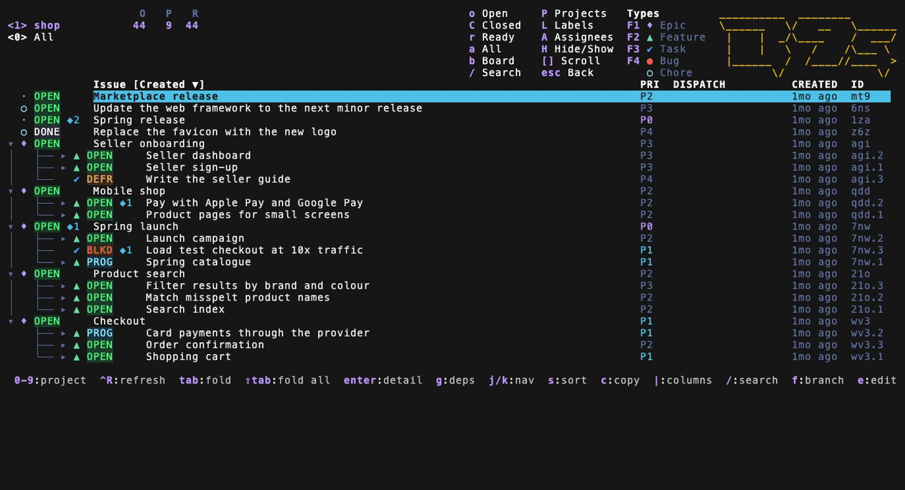
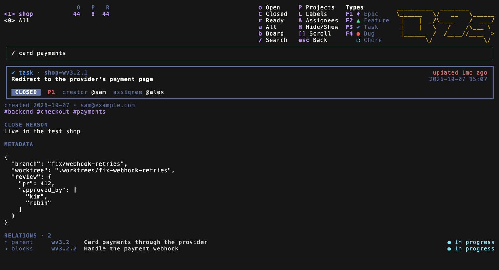
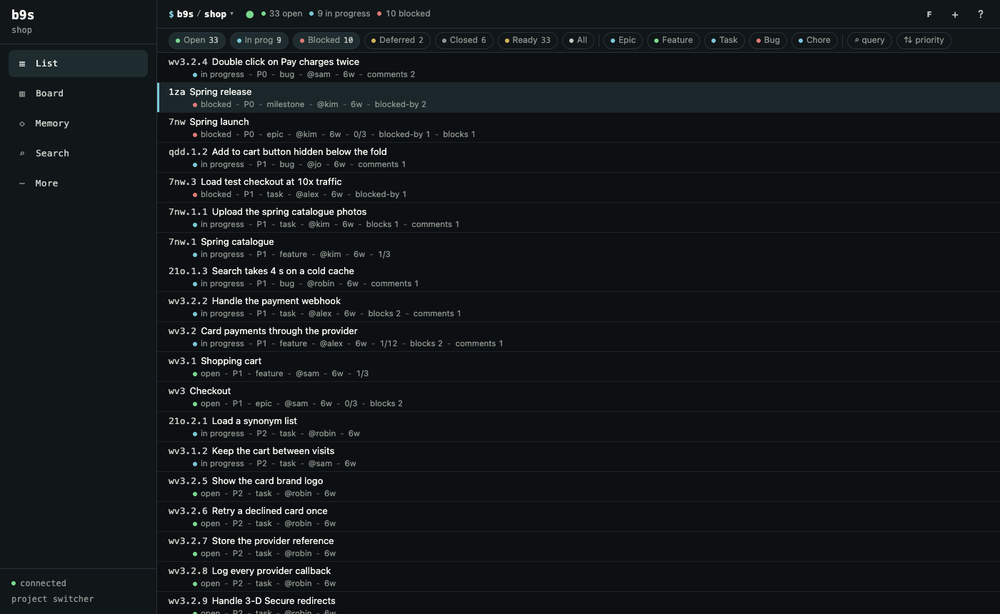

<!--
Release notes for v1.3.6, published as the body of the GitHub release.

Covers every commit from v1.3.5 to v1.3.6: pull requests #60, #73 and #78 on
main, and #42 and #61 to #89 on the release candidate. GoReleaser appends the
"## Changelog" section with the commit list, so it is not written here.
The walkthrough video is docs/videos/release-v1.3.6--main.mp4.
The GIFs and the screenshots are in docs/releases/v1.3.6/ and are linked at the v1.3.6 tag.
The TUI GIFs are recorded with vhs on examples/sample-project.
-->

## Highlights

### Preview another issue without leaving your place

`Ctrl-P` opens a read-only preview of an issue in a modal. On a tree row, a flat list row or a board card it previews the selected issue directly. In the detail pane it opens a chooser that lists related and mentioned issues first, and typing an ID or a title searches every loaded issue, including the ones the current filter hides.

The preview scrolls, cycles through a child issue's siblings with `n` and `p`, and has no issue actions. `Esc` returns to the detail or row you came from, with its selection, query, scroll position and child history intact.

The `:preview` command does the same, so an entry in `hotkeys.yaml` with `command: preview` puts the preview on any key you like. (#68)

### Reach every child of a large parent

The numbered children in the detail pane stop at nine, and until now so did the keyboard. In tree detail, `1`-`9` open a numbered child, and `n` and `p` then move through all its visible siblings, with no nine-child limit. `Backspace` still returns to the parent after any number of sibling moves. The keys skip siblings that the filter hides, and they leave the filter as it is. (#66)

### A search field that edits like a text field

`Left` and `Right` move the caret through the query. Typed and pasted text goes in at the caret, and `Backspace` deletes the character before it. (#67)

With a typed query, `Up` and `Down` keep the query, hide the field and move into the results, so you can type and then walk the matches without pressing `Enter` first. With an empty query they recall submitted queries as before, and `Alt-Up` and `Alt-Down` recall history from any draft. A query accepted with an arrow key joins the history the same way as one accepted with `Enter`. (#72)

### More of the issue in the detail view

The terminal and web details show **Close Reason** and **Metadata** when those fields hold data. Metadata appears as formatted JSON, including branch names, worktree paths and nested values, and an empty metadata object stays hidden. Copying an issue as Markdown includes both sections. (#69)

The detail pane, the board detail and the Creator and Assignee columns of the tree show the identity name with the stored alias beside it when the two differ, for example `@alice (@asmith)`. The person columns grow to fit, up to a quarter of the terminal width each, and shrink again when the title needs the room. (#82)

### Copy over SSH and from containers

A new `clipboard` setting chooses how b9s copies. `auto`, the default, tries the system clipboard utility and falls back to OSC 52 when that utility fails. `osc52` sends the copy directly to the terminal, which can reach your local clipboard through SSH or a container. `system` uses only the system utility. OSC 52 needs a terminal that supports it and permits clipboard writes, and a copy above 74,994 base64 bytes reports an error rather than writing part of it. (#70)

### Flat lists in the web view

The tree pane of `b9s web` has a tree layout and a flat list layout. `t`, or a tap on the active tab, switches between them, and the browser remembers the choice per project. A `type:` predicate, positive or negated, forces the flat list without changing the saved choice, because a query by type has no useful parent context. The list has one row per matching issue and sorts across the hierarchy. (#85)

### Arch Linux package

`packaging/arch` holds a `b9s-bin` recipe that packages the published release archive for x86_64 and aarch64, with pinned checksums and generated AUR metadata. (#60)

## Fixes

- **Close confirmation:** `Enter` confirms closing an issue, as `Y` does. `Esc` cancels. (#76)
- **Defer dates:** entering or changing a date in Defer until sets the status to deferred, and clearing the date returns a deferred issue to open unless you select another status. An unchanged date keeps the schedule. (#77)
- **Deferral dates from SQLite:** the SQLite reader loads `defer_until`, so the deferred sort and the detail view work on that source too. (#87)
- **Releases on every source:** release data is derived from the loaded milestone issues for Dolt, SQLite and JSONL alike, without a second query. (#61)
- **Mouse preference:** `:mouse` saves the choice as `ui.mouse` in `config.yaml`, and it applies on the next start. (#71)
- **Configuration errors:** a configuration file that does not load prints its path and the error to stderr, where b9s previously started with the defaults and said nothing. (#83)
- **Sort fields:** `pagerank` is no longer a sort field. No scores reached the tree, so it sorted by ID without saying so. See the upgrade notes. (#84)
- **Badge contrast:** status and priority badge text keeps its theme colour only when its contrast against the fill is at least 4.5:1, and otherwise uses black or white. This covers the status chip in the detail card and every terminal colour depth. (#75)
- **Footer hints:** the flat list footer no longer names folding keys, which do nothing there, and numeric hints name the active filter. Every footer shortcut in every view is now exercised by a test. (#74, #89)
- **Help overlay:** rows and headings line up. (#88)
- **Edit form:** the line under the form title names `Ctrl-S`. (#73)
- **Attachments:** the opener result stays visible in the footer when the download path is longer than the terminal is wide. (#65)
- **Preview deployments:** a preview counts as ready only when both the web view and the terminal answer, local images build from a worktree, and the preview runs on clusters that enforce resource quotas. (#42, #64, #79)

## Upgrade notes

- **`Up` and `Down` in the search field changed.** With a typed query they now move into the results. Use `Alt-Up` and `Alt-Down` to recall history from a draft, or clear the field first.
- **A configuration that names `pagerank` as a sort field fails to load.** b9s prints the accepted fields and starts with the defaults. Replace it with one of priority, created, updated, title, status, type, deps or deferred.
- **`Ctrl-P` is a new global key** in the tree, the list, the board and the detail pane. It previews the selected issue. In the label picker, `Ctrl-P` no longer moves up: use `Up` or `k`. To preview on another key, bind `command: preview` in `hotkeys.yaml`.
- No change to the configuration format otherwise. A file without `clipboard` or `ui.mouse` uses `auto` and `true`.

## Documentation

- A walkthrough video of the release is in `docs/videos/release-v1.3.6--main.mp4`.
- The user guide documents the quick view, sibling navigation beyond nine children, the search field keys, the clipboard setting and the web flat list.
- A new ADR designs access to specification references through an explicit snapshot import. (#78)
- `docs/testing.md` describes the Dolt setup check that fails once and fast when a server is unavailable (#81), and the new terminal proofs for Mermaid sequence diagrams (#62), full issue IDs in detail headers (#80) and tree jump selections (#86).
- The repository carries a sanitized snapshot of the b9s issues as a sample fixture, with a read-only refresh script. (#63)
